# AI On-Call Agent (MCP) — Implementation Plan

| | |
|---|---|
| **Status** | In progress: phases 1–13, 15–20, 22 done; 14, 21, 23–32 open |
| **Last updated** | 2026-10-05 |
| **Target spec / SDK** | MCP 2026-07-28, Python SDK `mcp` 2.2 (both apps) |
| **LLM access** | LangChain `init_chat_model`, provider chosen by `LLM_MODEL` (`provider:model`) |
| **Runtime** | Docker Compose + kind on Windows (Docker Desktop + WSL2); agentgateway v1.6.0 |
| **Remaining effort** | about 9 weeks (12 phases) |

---

## 1. Objective

- Build an AI on-call agent that investigates incidents in a Kubernetes system through MCP and
  writes a grounded incident report, proposing fixes that run only with a second person's
  approval.
- Measure every change: no phase is kept without a before/after comparison in Langfuse
  (`make replay`, `make eval`).

### In scope
- AI server (FastAPI + LangGraph), two MCP servers (Kubernetes, Prometheus) behind an MCP gateway
- MCP features: tools, resources, prompts, completions, progress, sampling, elicitation, auth
- The lab: kind cluster, sample services, Prometheus, injected incidents
- Evaluation, tracing and experiments in Langfuse
- LLM engineering techniques (part D): eval rigor, caching, resilience, routing, RAG,
  groundedness, conversations, multi-agent, alerts, distillation

### Out of scope
Production deployment (real cluster, cloud), multi-tenant use, a web UI, MCP servers for systems
other than Kubernetes and Prometheus, horizontal scaling of the MCP servers (see the separate
`mcp-scaling-patterns` project).

---

## 2. Solution overview

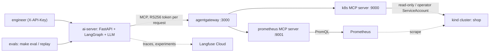

### Completed phases

| Phase | Delivered | Measured result |
|---|---|---|
| 1–4 | MCP server with fake tools, AI server + MCP client, Streamable HTTP, Docker | `make up` runs without a cluster |
| 5–7 | kind lab with three services, read-only Kubernetes tools, Prometheus tools | RBAC verified by integration tests |
| 8 | LangGraph investigation: fixed checks + LLM reasoning | — |
| 9 | Incident injection + graded eval, replay of saved evidence | 6/6 incidents, twice in a row |
| 10–12 | Langfuse tracing, dashboards, eval/replay runs as experiments | every investigation traced |
| 13 | Team knowledge as MCP resources (runbooks, topology, deployment specs) | 6/6, +4% tokens, same cost |
| 15 | Live progress over SSE, MCP progress, cancellation | — |
| 16 | Tool annotations, completions | read-only enforced by the client |
| 17 | MCP sampling for log summaries, strong/fast model routing | 4× more log lines, −18% strong-model tokens |
| 18 | Write tools with human approval (elicitation), operator ServiceAccount | rollback: error rate 100% → 0% |
| 19–20 | API keys, JWT tokens to MCP, roles, four eyes, audit log | refusals and approvals verified live |
| 22 | Two MCP servers behind agentgateway (mandatory), RS256 tokens | eval 6/6 direct; gateway +1–4 ms per call |

---

## 3. Repository structure

```
ai-oncall-agent/
├── PLAN.md, README.md, CODING_GUIDELINES.md, SECURITY.md, LICENSE
├── Makefile                      # every command (make help)
├── ruff.toml                     # shared lint rules
├── compose.yaml, compose.kind.yaml
├── .github/workflows/ci.yml
├── ai-server/                    # the agent, organized by domain
│   ├── main.py, config.py, errors.py, health.py, tracing.py, constants.py
│   ├── investigation/            # router, schemas, service, models, prompts, events
│   │   ├── workflow/             # graph, nodes, state
│   │   └── evidence/             # collection_steps, analysis, mcp_toolbox
│   ├── actions/                  # approved changes: router, registry, schemas
│   ├── auth/                     # API keys, MCP tokens
│   ├── llm/                      # chat model, model router, sampling
│   ├── mcp_client/               # connection, gateway mapping, LangChain adapter
│   └── tests/
├── mcp-platform/
│   ├── server/                   # two MCP servers, one codebase
│   │   ├── base_server.py, config.py, constants.py, tool_definitions.py
│   │   ├── auth/                 # tokens, roles
│   │   ├── audit/                # log, middleware, report
│   │   ├── k8s/                  # server, pods, deployments, events, knowledge, cluster/
│   │   ├── prometheus/           # server, tools, metrics/
│   │   ├── knowledge/            # runbooks, topology (data)
│   │   ├── deploy/               # RBAC for the k8s server
│   │   └── tests/
│   └── gateway/agentgateway.yaml
├── lab/
│   ├── services/                 # user-, payment-, order-service
│   └── kubernetes/               # base/ (per workload), incidents/, monitoring/
├── evals/                        # incident_cases, run_eval, replay, experiment_tracking
└── docs/                         # architecture, lab, evals, observability, mcp-features, actions-and-security
```

New phases add modules to the existing domain folders; a new top-level folder needs a purpose none
of the existing ones has (CODING_GUIDELINES §5).

---

## 4. Engineering standards

Sources: PEP 8, PEP 257, PEP 484, the Python Packaging User Guide, FastAPI best practices
(zhanymkanov), AWS MCP server design guidelines, Kustomize docs, the Compose specification, the
Twelve-Factor App. Project rules in full: [CODING_GUIDELINES.md](./CODING_GUIDELINES.md).

### 4.1 Directory structure
| Rule | Source |
|---|---|
| Organize by domain, not by file type: each domain has `router.py`, `schemas.py`, `dependencies.py`, `constants.py`, `service.py` as needed | FastAPI best practices |
| Inside an MCP server: tools grouped by the object they act on; API access in its own folder (`access.py`, `<system>_api.py`, `fake.py`) | AWS MCP design guidelines, kubernetes-mcp-server |
| Organize by concern, never by mechanism (no shared `middleware.py` for two concerns) | single responsibility |
| Flat over nested; no folder holding one module; `__init__.py` is a docstring | PEP 20 |
| One `pyproject.toml` per Python project, extending the root `ruff.toml` | PEP 518/621 |
| Kustomize base (one folder per workload) + overlays (`incidents/`) | Kustomize docs |
| Compose files `compose.yaml`, `compose.<purpose>.yaml` | Compose specification |
| A local name never shadows an installed library (`k8s/`, `mcp_client/`) | avoids import bugs |

### 4.2 Naming
| Item | Convention | Example |
|---|---|---|
| Packages | short, lowercase | `investigation`, `k8s`, `audit` |
| Modules | `snake_case`, named after their contents | `collection_steps.py`, `kubernetes_api.py` |
| Classes | `CapWords` nouns | `ClusterReader`, `McpServerGroup` |
| Functions | `snake_case`, verb first | `build_pod_tools()`, `extract_trace_id()` |
| Factory prefixes | `create_` makes an object holding a resource; `build_` assembles a value | `create_reader()`, `build_query()` |
| FastAPI dependencies | `get_x` + `XDep` alias | `get_current_user` → `CurrentUserDep` |
| Constants | `UPPER_SNAKE_CASE` in the domain's `constants.py` | `MAX_LOG_LINES` |
| Settings | `<Component>Settings`, env vars with a prefix | `K8sServerSettings`, `MCP_K8S_SERVER__PORT` |
| Tests | `test_<behaviour>_<condition>` | `test_requester_cannot_approve_their_own_action` |

### 4.3 Code
- Type hints on public functions (PEP 484); docstrings for modules, classes and non-obvious
  functions (PEP 257); comments only for a non-obvious *why*.
- Tunables in `config.py` (pydantic-settings, env/`.env`); fixed values in `constants.py`;
  secrets only in gitignored `.env` and `keys/`.
- Provider-agnostic LLM access: no provider SDK imports, only `LLM_MODEL` + key.
- No functions nested in functions except tool factories and small callback factories.
- Fakes behind the same interface as the real system; the fake mode (`MCP_BACKEND=fake`) keeps
  `make up` and the tests cluster-free.

### 4.4 Tooling and workflow
- **ruff** (`make lint`), **pytest** (`make test`), **CI** on every push (lint + unit and
  integration tests without cluster or LLM).
- **Git:** commit and push after each tested unit; author Aman Kumar.
- **Open items:** enable PEP 8 rule sets (`E, W, N`) and `ruff format` at line length 99;
  rename `MCP_BACKEND` to a clearer name; confirm the first CI run on GitHub.

---

## 5. Phases

Order: 23 → 24 → 25 → 26 → 14 → 27 → 28 → 29 → 21 → 30 → 31 → 32. Each phase:
**goal → architecture → deliverables → tasks → acceptance criteria → tests**.

---

### Phase 23 — Evaluation rigor

**Goal:** comparisons with stated noise: more incidents, repeated runs, a CI gate.

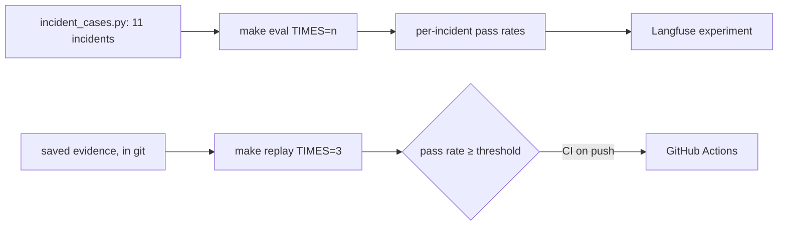

**Deliverables:** five new incidents, repeated-run summaries, replay suite in git, CI gate, new
baseline.

**Tasks**
- [ ] `make eval TIMES=n` and `make replay TIMES=n`; per-incident pass rate in the summary and Langfuse
- [ ] New incidents (overlay + case each): `memory-leak`, `bad-config`, `dns-failure`, `two-incidents`, `no-incident`
- [ ] high-cpu symptom check requires CPU throttling ≥ 25%, not only latency; a case whose fault doesn't reproduce reports "not reproduced" instead of a wrong answer
- [ ] Replay suite: saved evidence of every incident committed (no secrets), replayed in CI with `TIMES=3`
- [ ] Baseline: today's agent, `make eval TIMES=3` on all 11 incidents

**Acceptance criteria:** 11 incidents covered; the replay gate runs in CI; baseline pass rates
recorded in this file.

**Tests:** unit tests for the summary maths; each new overlay renders (`kubectl kustomize`); the
symptom checks fire on an injected incident and stay quiet on a healthy cluster.

---

### Phase 24 — Prompt caching and context engineering

**Goal:** most of the report step's input served from the provider's prompt cache, at the same
pass rate.

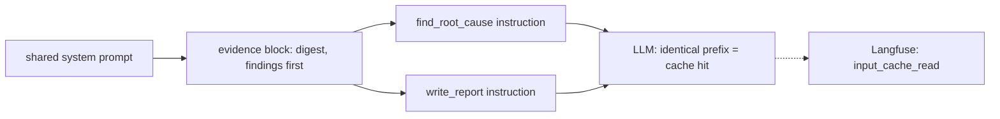

**Deliverables:** reordered prompts with a shared prefix, evidence digest, cache metrics in the
README.

**Tasks**
- [ ] One shared system prompt + evidence block first, step instruction last
- [ ] Evidence digest: drop healthy noise, compact JSON, per-tool token budget, `computed_findings` on top
- [ ] Record cache-read share per investigation from Langfuse

**Acceptance criteria:** cache-read share of the report step > 50%; cost per investigation lower;
pass rate unchanged (`make replay TIMES=3`, then `make eval TIMES=2`).

**Tests:** prompt-builder unit tests assert the prefix is byte-identical across steps; digest
tests on saved evidence.

---

### Phase 25 — Resilience: fallbacks, retries and budgets

**Goal:** a report even when the primary model fails; no investigation over its budget.

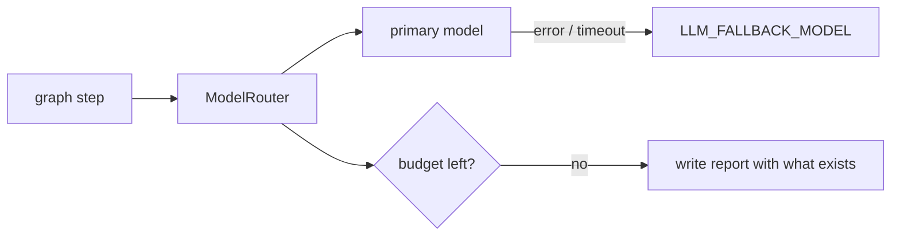

**Deliverables:** fallback model, retries with backoff, per-investigation token/time budgets,
markers in trace and report.

**Tasks**
- [ ] `LLM_FALLBACK_MODEL` via `with_fallbacks` in `ModelRouter`; fallback marked in trace and report
- [ ] `MAX_INVESTIGATION_TOKENS`, `MAX_INVESTIGATION_SECONDS`; skip optional work when reached
- [ ] Retries with backoff for transient provider errors

**Acceptance criteria:** with a broken primary key the eval still passes; budgets visible in the
trace; no run exceeds them.

**Tests:** failing fake chat model, slow fake MCP tool, budget exhaustion path.

---

### Phase 26 — Model routing II: matrix, cascading, self-consistency

**Goal:** each LLM step's model chosen by data; escalation only when a check fails.

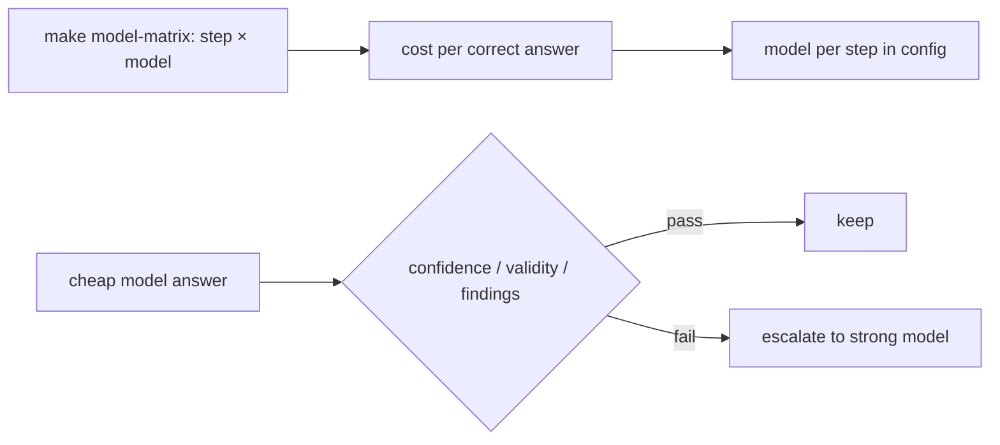

**Deliverables:** model matrix experiment and results table, cascading in `ModelRouter`, optional
self-consistency for `find_root_cause`.

**Tasks**
- [ ] `make model-matrix` (replay) over candidate models for `write_report` and `extract_incident_scope`
- [ ] Cascading: a step declares an escalation check
- [ ] Optional self-consistency when confidence is medium or low

**Acceptance criteria:** every step's model picked from the matrix; cascading lowers cost at the
same pass rate.

**Tests:** escalation triggered by each check type with scripted models.

---

### Phase 14 — Prompts

**Goal:** the investigation recipes offered as MCP prompts to any MCP host.

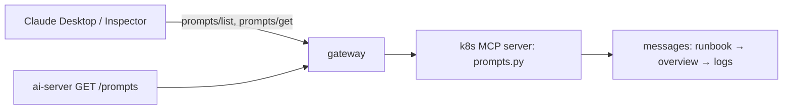

**Deliverables:** `k8s/prompts.py` with `investigate_service`, `explain_pod_failure`,
`summarize_deployment_history`; `GET /prompts` in the AI server.

**Tasks**
- [ ] Three prompts referencing the right tools and resources
- [ ] Gateway rule for prompts (`mcp.prompt.target`), name mapping in `McpServerGroup`
- [ ] `GET /prompts` (health/tools style)

**Acceptance criteria:** the prompts work from MCP Inspector and Claude Desktop through the
gateway.

**Tests:** prompts listed with arguments; `get_prompt` fills them; a missing argument is an error.

---

### Phase 27 — Incident memory: RAG over past incidents and runbooks

**Goal:** similar past incidents and runbook sections in the root-cause prompt.

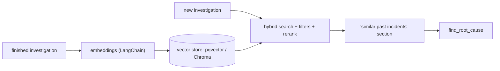

**Deliverables:** incident store, retrieval step, optional `past_incidents://` resource, retrieval
evaluation.

**Tasks**
- [ ] Store report, findings and key evidence of each finished investigation
- [ ] Retrieval before `find_root_cause`: namespace/service filters, hybrid search, rerank
- [ ] Retrieval eval: same-incident run in the top 3

**Acceptance criteria:** the matching past incident is retrieved for most cases; pass rate does not
drop on the Phase 23 set.

**Tests:** retrieval unit tests with a fixed corpus; embedding provider mocked.

---

### Phase 28 — Groundedness: citation checks, LLM-as-judge, guardrails

**Goal:** every report checked against its evidence before it's shown.

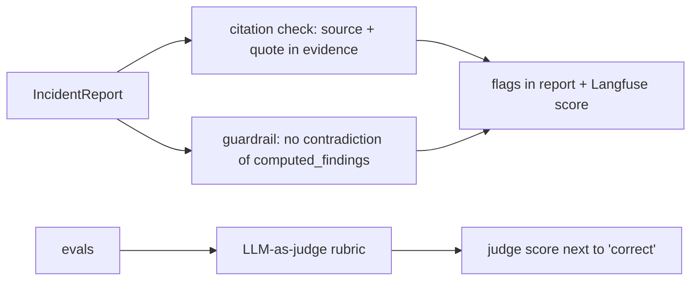

**Deliverables:** citation check, findings guardrail with one retry, judge score in experiments.

**Tasks**
- [ ] Code check of every `EvidenceCitation`
- [ ] Guardrail on `computed_findings`; retry once or mark the report
- [ ] LLM-as-judge (cheap model, fixed rubric) in evals

**Acceptance criteria:** every report carries a groundedness result; judge score present in
experiments; its agreement with `correct` measured.

**Tests:** fabricated, misquoted and valid citations; contradiction detection.

---

### Phase 29 — Conversations and human-in-the-loop

**Goal:** follow-up questions reuse an investigation's state; the graph can pause for a human.

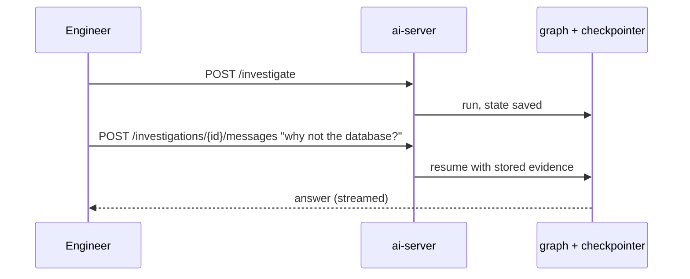

**Deliverables:** conversation endpoint, LangGraph checkpointer, interrupt before sensitive steps.

**Tasks**
- [ ] `POST /investigations/{id}/messages` with a checkpointer (SQLite/Postgres)
- [ ] Follow-up tool calls allowed; streamed like `/investigate/stream`
- [ ] Interrupt + resume

**Acceptance criteria:** a follow-up answer without re-collecting evidence (fewer tokens, less
time); a paused graph resumes after a human answer.

**Tests:** resume from checkpoint; interrupt/resume with the scripted model.

---

### Phase 21 — Hardening

**Goal:** tool output can't steer the agent; limits on calls and sizes; transport and network
locked down.

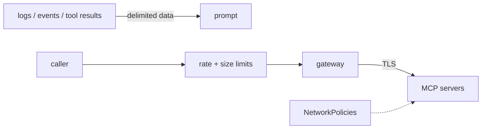

**Deliverables:** injection defenses + injection incident, rate/size/LLM-call limits, TLS,
NetworkPolicies, dependency and image scanning.

**Tasks**
- [ ] Tool results passed as delimited data; system prompt says so
- [ ] Incident case: a pod logging injection attempts
- [ ] Per-caller and per-tool rate limits (gateway), size limits on results and resources, LLM-call cap
- [ ] TLS between services; NetworkPolicies; secrets from Kubernetes Secrets
- [ ] Dependency and image scanning in `make`

**Acceptance criteria:** the injection case passes in `make eval` with no regression; a security
review finds no open item.

**Tests:** limit enforcement, oversized results, injection fixtures in replay.

---

### Phase 30 — Multi-agent specialists vs. one graph

**Goal:** a measured answer to whether specialist agents beat the single graph here.

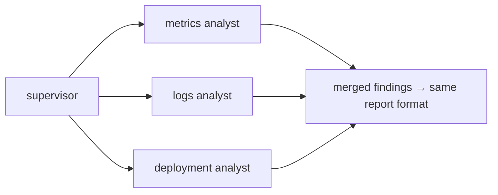

**Deliverables:** `INVESTIGATION_MODE=multi_agent` graph with the same tools and report;
comparison in the README.

**Tasks**
- [ ] Supervisor + three specialists
- [ ] Same report schema; both modes in the eval

**Acceptance criteria:** pass rate, cost, latency and tokens of both modes on the Phase 23 set
published; the better mode is the default.

**Tests:** supervisor routing with scripted models.

---

### Phase 31 — Proactive on-call: alert → investigation → chat

**Goal:** an alert starts the investigation and posts the report.

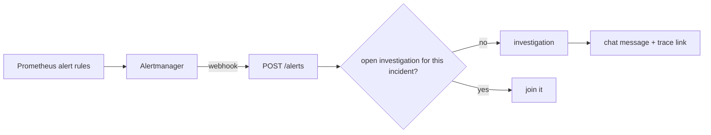

**Deliverables:** alert rules, `POST /alerts` with deduplication, chat sink (Slack webhook or local
log sink).

**Tasks**
- [ ] Alert rules: error rate, latency, restarts
- [ ] Webhook → question → investigation; dedup window from config
- [ ] Post report with Langfuse link

**Acceptance criteria:** `make incident NAME=db-down` produces a chat message with the right root
cause without anyone asking; time to report measured.

**Tests:** webhook payload parsing, dedup window, sink called once.

---

### Phase 32 — Distillation

**Goal:** a fine-tuned small model matching the strong model on held-out incidents, or a measured
reason why not.

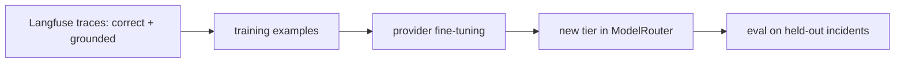

**Deliverables:** export script, fine-tuned model, held-out comparison.

**Tasks**
- [ ] Export correct, grounded traces; train/test split by incident
- [ ] Fine-tune through the provider; add as a router tier
- [ ] Compare on held-out incidents

**Acceptance criteria:** comparison published with cost per correct answer.

**Tests:** export format validation; no held-out incident in the training set.

---

## 6. Test strategy

### 6.1 Test levels
| Level | Tool | Target | Gate |
|---|---|---|---|
| Unit | pytest; scripted chat model; MCP servers through an in-process client | each app's `tests/` | `make test`, CI |
| Integration (no cluster) | real MCP server processes, real HTTP, tokens | `ai-server/tests/integration` | CI |
| Cluster integration | kind: RBAC, Kubernetes and Prometheus APIs | `mcp-platform/server/tests/integration` | before each commit touching infra |
| Replay | saved evidence, LLM only | `make replay` | every phase; CI gate from Phase 23 |
| Eval | injected incidents end to end | `make eval` | every phase that changes evidence or reasoning |
| Contract | tool/resource definitions before vs after | dump comparison | every refactor |
| Manual | MCP Inspector, Claude Desktop | running servers | MCP feature phases |

### 6.2 Measurement protocol (every phase)
1. Baseline: `make replay` (and `make eval` if evidence changes), recorded as a Langfuse experiment.
2. Change, with tests.
3. Same experiment again; compare pass rate, confidence, tokens, cost, latency.
4. A phase that makes the agent worse isn't done.

### 6.3 Environment cleanup (after every Docker session)
Stop servers → `docker compose down` → `make cluster-down` → quit Docker Desktop → `wsl --shutdown`.

---

## 7. Tech stack

| Concern | Choice |
|---|---|
| Language / MCP | Python 3.11, `mcp` 2.2 |
| AI server | FastAPI, LangGraph, LangChain (`init_chat_model`) |
| MCP gateway | agentgateway v1.6.0 |
| Lab | kind, Kustomize, Prometheus, three FastAPI services |
| Auth | API keys, RS256 JWT (PyJWT), JWKS |
| Observability | Langfuse (traces, experiments, scores) |
| Config | pydantic-settings + `.env` |
| Testing | pytest, anyio, MCP in-process client, httpx ASGI transport |
| Quality | ruff, GitHub Actions |
| Planned | pgvector or Chroma (27), Alertmanager (31), provider fine-tuning (32) |

---

## 8. Schedule

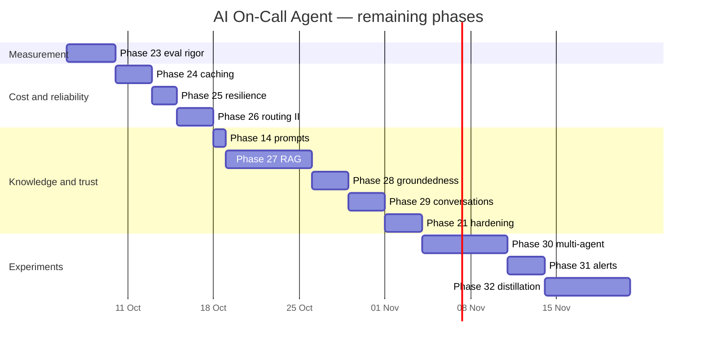

### Definition of done (each phase)
- [ ] Baseline and after-run compared in Langfuse; no regression
- [ ] `make lint` clean; `make test` passes; CI green
- [ ] Contract check unchanged where the phase isn't meant to change tools
- [ ] Live check on kind where infra or MCP behaviour changed
- [ ] README / docs / CODING_GUIDELINES updated; this file's status updated
- [ ] Committed and pushed; environment cleaned up

---

## 9. Risks and mitigations

| Risk | Impact | Mitigation |
|---|---|---|
| Eval noise (one run, few incidents) | wrong conclusions | Phase 23 first: repeated runs, more incidents, stated pass rates |
| Incident faults don't reproduce (fading CPU load) | false failures | symptom checks require the fault signal; "not reproduced" result |
| LLM provider outage or price change | no reports / cost spike | Phase 25 fallbacks and budgets; provider-agnostic models |
| Prompt injection through logs | harmful recommendations | Phase 21 defenses; changes need two people regardless |
| MCP SDK / spec changes | broken builds | pin `mcp`; check release notes at each phase start |
| Gateway lacks a feature (prompts, newer spec) | phase blocked | spike checklist before relying on it; own gateway as fallback |
| Overfitting to the lab's incidents (27, 32) | false confidence | held-out incidents; retrieval eval |
| Docker Desktop memory on Windows | flaky runs | one stack at a time; cleanup routine (6.3) |

### Backlog (not scheduled)
User feedback scores in Langfuse, Prometheus metrics for the agent itself, OpenTelemetry tracing
in the MCP servers, Langfuse prompt management, Batch API for evals, semantic caching.

---

## 10. References
- MCP specification — https://modelcontextprotocol.io/specification
- MCP Python SDK — https://github.com/modelcontextprotocol/python-sdk
- agentgateway — https://agentgateway.dev/docs/
- LangGraph — https://langchain-ai.github.io/langgraph/
- Langfuse — https://langfuse.com/docs
- AWS MCP server design guidelines — https://github.com/awslabs/mcp/blob/main/DESIGN_GUIDELINES.md
- FastAPI best practices — https://github.com/zhanymkanov/fastapi-best-practices
- PEP 8 — https://peps.python.org/pep-0008/
- PEP 257 — https://peps.python.org/pep-0257/
- PEP 484 — https://peps.python.org/pep-0484/
- Python Packaging User Guide, project layout — https://packaging.python.org/en/latest/discussions/src-layout-vs-flat-layout/
- Kustomize — https://kubectl.docs.kubernetes.io/references/kustomize/
- Compose specification — https://docs.docker.com/compose/compose-application-model/
- Twelve-Factor App, config — https://12factor.net/config
