# AI On-Call Agent (MCP)

[](https://github.com/ak7270090/ai-oncall-agent/actions/workflows/ci.yml)
[](./LICENSE)

An AI teammate for on-call. When something breaks in production, you tell it what's going on in
plain English, the way you'd message a colleague, and it does the digging for you.

---

## The problem

Your phone buzzes at 2 a.m.: "Checkout is broken." You open your laptop, still half asleep, and
start the usual routine:

- *Which pods are unhappy?* `kubectl get pods`, then scroll.
- *What are they saying?* Read through hundreds of log lines, looking for the one that matters.
- *Did someone deploy something?* Check the rollout history.
- *Is it this service, or something it calls?* Open Grafana and stare at the error and latency
  graphs, one service after another.

Twenty minutes later you find it: the payments database is down, and everything above it is
failing because of it. The fix took one command. Finding it took all the time.

## What this agent does

You ask it the same question you'd ask a teammate: *"Checkout is failing, what's wrong?"* It then
does what you would have done, only faster:

- 🔍 **Looks at your pods:** which ones are crashing, restarting, or not ready.
- 📜 **Reads the logs for you** and pulls out the lines that matter, like
  `connection refused to payments-db`, instead of handing you a wall of text.
- 📈 **Checks the graphs:** error rate, latency and CPU for every service, from Prometheus.
- 🕐 **Checks what changed:** a new deployment five minutes before the errors started is a big hint.
- 🧭 **Follows the chain:** if `order-service` fails because `payment-service` fails because the
  database is down, it walks down to the real cause instead of blaming the first service it sees.
- 📖 **Reads your runbooks**, the notes your team wrote about each service.

Then it gives you a short report: what's broken, why, the evidence for each claim, and a
suggested fix.

**It can't break anything on its own.** By default it can only look, never touch. If it suggests
a fix, like rolling back a bad release, someone has to ask for it, and a *second* person has to
approve it. Everything it does is written to an audit log.

---

## Example: a bad release on a Friday evening

- **18:05**: the team ships a new version of `payment-service` and heads home.
- **18:09**: customers start reporting that orders fail at checkout.
- **18:10**: Neha is on call, opens a laptop and asks the agent:

> "Orders have been failing since the latest release. Please investigate."

<p align="center">
  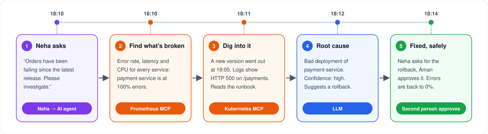
</p>

**18:12**: here's what Neha gets back:

> **Incident:** orders fail because payment-service returns HTTP 500 since the latest rollout.
>
> **Root cause:** bad deployment of `payment-service` (confidence: high).
>
> **Evidence:**
> - Prometheus: payment-service error rate 100%; every other service looks healthy.
> - Kubernetes: a new version went out at 18:05, and the errors start at the same minute.
> - Logs: `POST /payments 500 Internal Server Error`.
>
> **Suggested fix:** roll `payment-service` back to the previous version.

Neha didn't run a single `kubectl` command. Neha asked for the rollback, Aman approved it from a
phone, and checkout was working again by 18:14.

---

## Demo: the same incident, for real

Everything below comes from one real run on the local kind cluster. A broken `payment-service` v2
was rolled out, the agent was asked *"Orders have been failing since the latest release. Please
investigate."*, and the rollback went through the full approval flow.

### 1. You watch it work, live

Every step, tool call and LLM call streams in as it happens. Look for the **MCP sampling**
lines: the Kubernetes MCP server asks the agent's LLM to summarize long pod logs. The whole
investigation took 18 seconds.

<p align="center">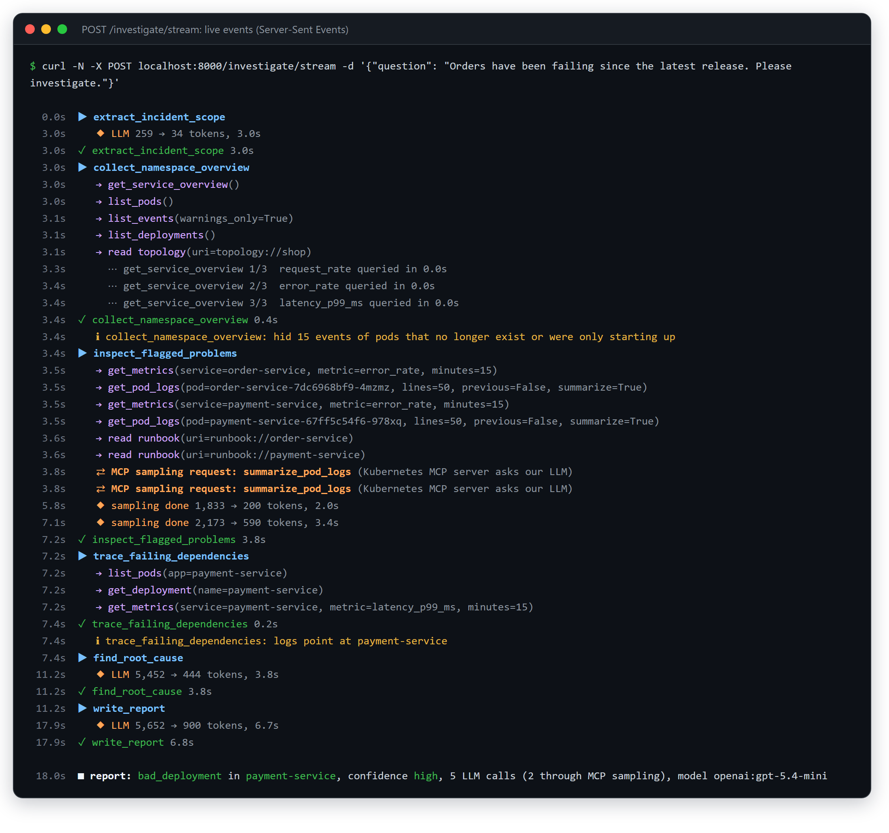</p>

### 2. The report it writes

Every claim quotes the evidence it came from. Here it found the real bug, `KeyError: 'currency'`
in the new version, and proposed rolling back to revision 1.

<p align="center">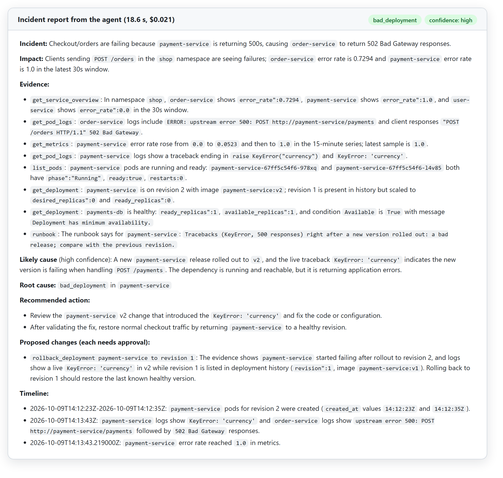</p>

### 3. The fix, approved by a second person

Neha asks for the rollback. The MCP server stops and asks for approval. Nobody can approve their
own request, so Aman approves it, the rollback runs, and the audit log records who did what.

<p align="center"></p>

### 4. Errors back to zero

The error rate in Prometheus: `payment-service` (teal) jumps to 100% when v2 goes out, with
`order-service` failing along with it, and both drop to 0 right after the approved rollback.

<p align="center">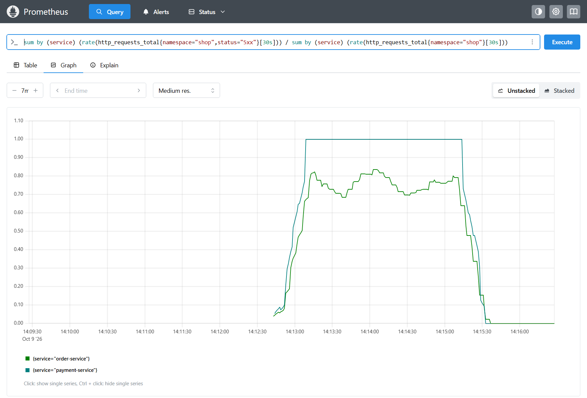</p>

### 5. Every step recorded in Langfuse

The whole investigation is one trace in Langfuse: every step, tool call and LLM call on a
timeline, with its duration and cost, next to the report it produced.

<p align="center">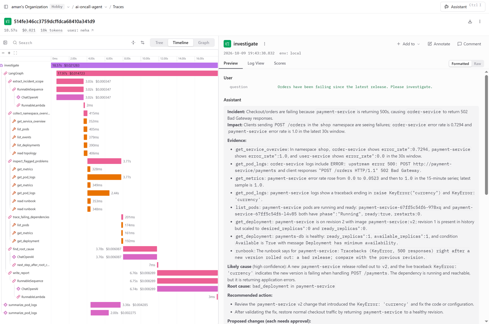</p>

Click any LLM call to see exactly what the model was given. Here, the root-cause step got its
instructions, the current time and every piece of evidence:

<p align="center">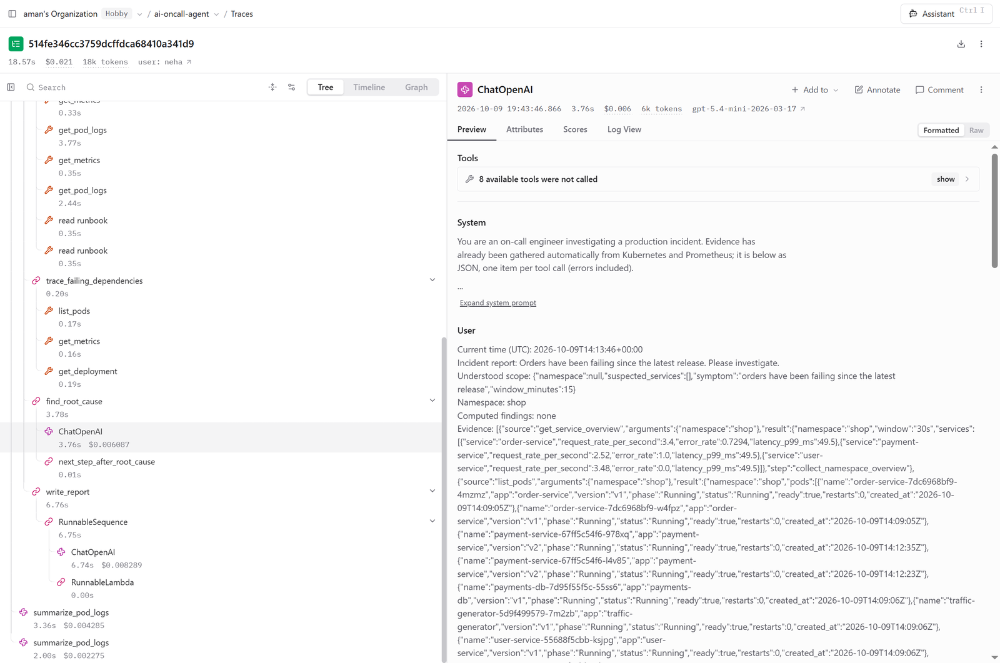</p>

### 6. What it costs

From the Langfuse trace of this run: about $0.021 and 18.6 seconds for the whole investigation.

<p align="center">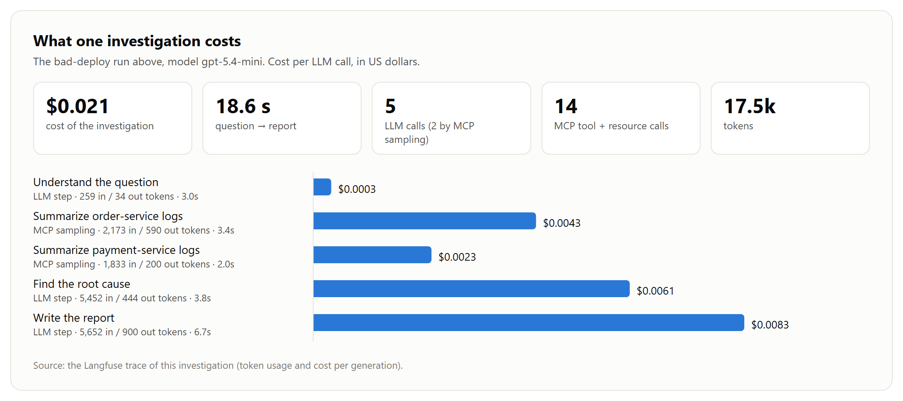</p>

### 7. How it's measured

Each eval run injects six real faults and grades the answers automatically. The same numbers
decide model choices: letting a smaller model write the report cut cost by 40%, but it got one
incident wrong, so it isn't the default.

<p align="center">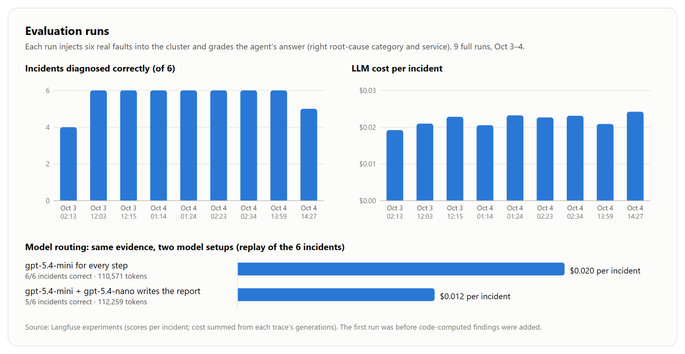</p>

That comparison in Langfuse, incident by incident: the cheaper setup (left) got 83% right against
100%, and the high-cpu incident at the bottom is the one it missed.

<p align="center">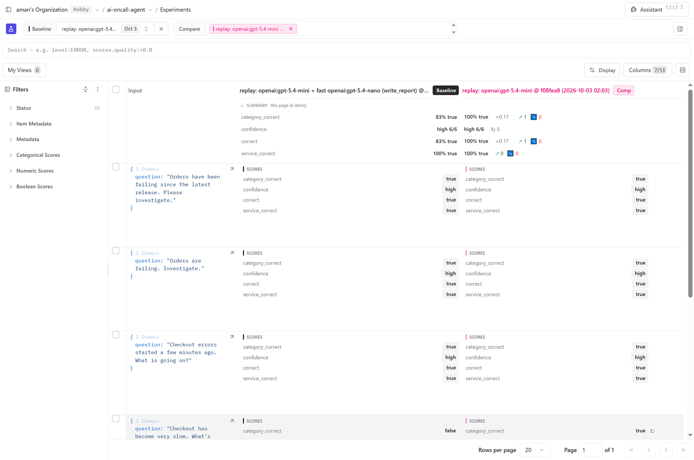</p>

And a month of building and testing, every eval, replay and demo run, adds up to 188 traces,
$3.14 in total, and 649 scores:

<p align="center">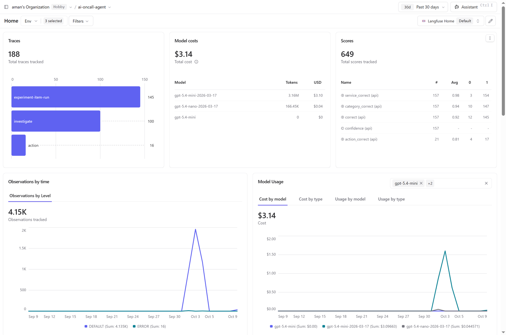</p>

---

## Architecture

<p align="center">
  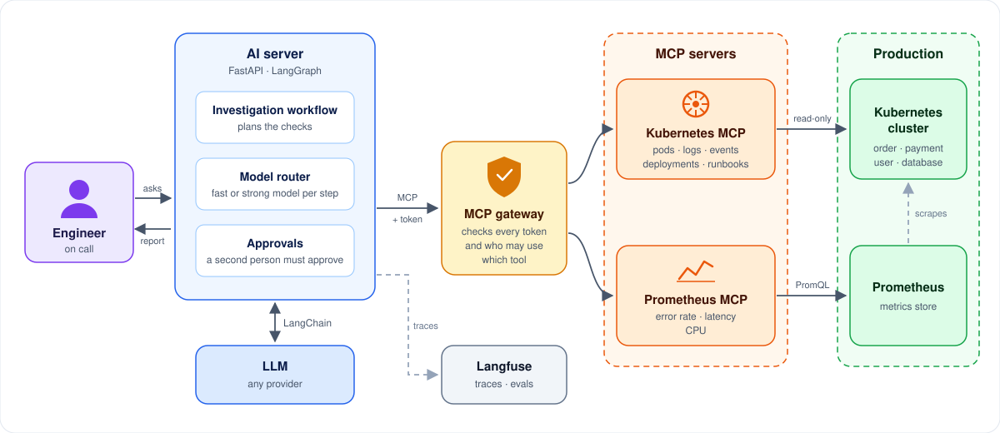
</p>

- **AI server:** the brain. It plans the investigation, picks a model for each step (a cheap,
  fast one for simple steps, a stronger one for the root cause) and handles approvals.
- **MCP gateway:** the front door. Every request carries a short-lived signed token, and the
  gateway decides which tools that person may use.
- **MCP servers:** the hands. One knows Kubernetes (pods, logs, events, deployments, runbooks);
  the other knows Prometheus (error rate, latency, CPU). They check the token again before doing
  anything.

---

## Concepts used

| Concept | In plain words |
|---|---|
| **MCP servers** | Two small servers, one for Kubernetes and one for Prometheus, that give the AI "tools" it can call, like *get pod logs* or *get error rate*. Any MCP-compatible AI app can use them. |
| **MCP gateway** | A single front door in front of the MCP servers. It checks who's calling and which tools they're allowed to use. |
| **MCP sampling** | The Kubernetes server has no AI of its own. When logs are too long, it asks the agent's LLM to summarize them, so the agent reads the key lines instead of thousands. |
| **MCP elicitation (human approval)** | Before anything changes in production, the MCP server stops and asks a human to approve, and that human must be a second person. |
| **Live progress streaming** | You watch the investigation as it happens ("checking pods… reading logs… found it"), instead of waiting for a final answer. |
| **Model routing** | Simple steps go to a cheap, fast model; the hard thinking goes to a stronger one. Same quality, lower cost. |
| **Agent workflow (LangGraph)** | A fixed checklist gathers the evidence first, and then the LLM reasons over it, so the agent doesn't wander or make things up. |
| **Grounded answers** | Every claim in the report points to the evidence it came from. |
| **Provider-agnostic LLM** | Switching between OpenAI, Anthropic, Gemini and others takes two settings and no code changes. |
| **Evals and replay** | Real failures are injected into the cluster, and the agent's answers are graded automatically. Replay re-runs only the reasoning in seconds, to compare prompts and models. |
| **Tracing and cost tracking (Langfuse)** | Every investigation shows every step, LLM call and tool call, with its tokens, cost and time. |

---

## Results so far

| Phase | Measurement |
|---|---|
| Fixed checks + computed findings | 6/6 incidents correct, twice in a row, high confidence |
| Team knowledge as MCP resources | 6/6, +4% tokens, same cost |
| Log summaries via sampling + model routing | 4× more log lines read, −18% strong-model tokens |
| Approved rollback | payment-service error rate 100% → 0% |
| MCP gateway | +1–4 ms per tool call |

---

## Run it locally

### Prerequisites

- Python 3.11+, Docker Desktop, `make`
- For the real cluster: `kind` and `kubectl`
- An API key for any LLM provider supported by LangChain
- Optional: a free [Langfuse](https://langfuse.com) account for tracing

**Windows:** run `make` from **Git Bash**. Install the tools once with
`winget install ezwinports.make Kubernetes.kind Kubernetes.kubectl`. WinGet's tools need to come
before Docker Desktop's older bundled `kubectl` on your PATH; add this to `~/.bashrc`:
`export PATH="$(cygpath -u "$LOCALAPPDATA")/Microsoft/WinGet/Links:$PATH"`.
**macOS:** `brew install make kind kubectl`.

### 1. Install

```bash
git clone https://github.com/ak7270090/ai-oncall-agent.git
cd ai-oncall-agent
make setup        # a virtualenv per app, creates the .env files from the examples
```

Set the model in `ai-server/.env`:

```ini
LLM_MODEL=openai:gpt-5.4-mini      # or anthropic:claude-sonnet-5-5, google_genai:..., ...
LLM_API_KEY=<key for that provider>
# optional
LLM_MODEL_FAST=openai:gpt-5.4-nano # cheaper model for the simple steps
LANGFUSE_PUBLIC_KEY=...
LANGFUSE_SECRET_KEY=...
```

### 2a. Quick start: fake data, no cluster

```bash
make up           # AI server, gateway, both MCP servers in Docker; waits until healthy
curl -s -X POST http://127.0.0.1:8000/investigate \
  -H "Content-Type: application/json" \
  -d '{"question": "Checkout is failing. What is wrong?"}'
```

Swagger UI is at http://127.0.0.1:8000/docs. Stop the stack with `make down`.

### 2b. Full lab: real incidents on kind

```bash
make cluster-up              # kind cluster + shop services + Prometheus + traffic
make up-kind                 # the stack + fresh short-lived cluster credentials

make incident NAME=db-down   # break something
# ask the agent (curl above), or watch it live:
curl -N -X POST http://127.0.0.1:8000/investigate/stream \
  -H "Content-Type: application/json" -d '{"question": "Checkout errors started. Why?"}'
make incident-reset          # back to healthy

make eval                    # all scenarios, graded (about 11 minutes)
make replay TIMES=3          # re-run only the reasoning on saved evidence
```

### 2c. Without Docker

```bash
make run-mcp-servers   # terminal 1: k8s MCP :9000, prometheus MCP :9001
make run-gateway       # terminal 2: agentgateway :3000 (downloads the binary once)
make run-ai-server     # terminal 3: http://127.0.0.1:8000
```

### Sign-in and approvals (optional)

Authentication is off while `API_KEYS={}`. To try roles and four-eyes approval, add keys in
`ai-server/.env` (for example two `lead` users and one `oncall`), then send `X-API-Key`. The
details are in [sign-in and roles](./docs/actions-and-security.md).

### Clean up

```bash
make down && make cluster-down
```

Then quit Docker Desktop. On Windows, also run `wsl --shutdown` to free the memory.

### Calling the tools by hand

Run `npx @modelcontextprotocol/inspector` and connect with Streamable HTTP to
`http://127.0.0.1:3000/mcp`, using a bearer token signed by `keys/mcp-token-private.pem`.

---

## API

| Endpoint | What it does |
|---|---|
| `GET /health` | Liveness of the AI server |
| `GET /ready` | Checks the MCP servers are reachable through the gateway |
| `GET /tools` | Tools offered by the MCP servers |
| `POST /investigate` | `{"question": "..."}` → incident report (JSON + Markdown), checks run, graph steps |
| `POST /investigate/stream` | Same, streamed as Server-Sent Events |
| `POST /actions` | Request a proposed fix; waits for approval |
| `GET /actions/{id}` | Status of an action |
| `POST /actions/{id}/approval` | `{"approve": true, "reason": "..."}`, by someone other than the requester |

Errors: MCP gateway unreachable → `503`; LLM provider failure → `502`.

---

## Commands

| Command | What it does |
|---|---|
| `make setup` | Virtualenvs, dependencies, `.env` files |
| `make up` / `make up-kind` / `make down` / `make logs` | The stack in Docker (fake data / kind cluster) |
| `make run-mcp-servers` / `make run-gateway` / `make run-ai-server` | Run the apps locally without Docker |
| `make cluster-up` / `make smoke-test` / `make cluster-down` | kind cluster with the sample services |
| `make redeploy` | Rebuild and restart the sample services |
| `make mcp-kubeconfig` | Fresh short-lived credentials for the MCP server |
| `make incident NAME=…` / `make incident-reset` | Inject an incident / return to healthy |
| `make eval [NAME=a,b]` | Run incidents end to end and grade the agent |
| `make replay [NAME=…] [TIMES=n]` | Re-run the reasoning on saved evidence |
| `make audit` | Report from the MCP servers' audit logs |
| `make test` / `make lint` | All test suites / ruff |

`make help` lists everything.

---

## Project structure

```text
ai-oncall-agent/
├── ai-server/             the agent (FastAPI + LangGraph), organized by domain
│   ├── investigation/     /investigate: graph (workflow/), evidence collection (evidence/), prompts, report models
│   ├── actions/           /actions: proposed fixes waiting for approval
│   ├── llm/               chat model, model router, sampling responder
│   ├── mcp_client/        MCP connection through the gateway, LangChain tool adapter
│   └── auth/              API keys, signed MCP tokens
├── mcp-platform/
│   ├── server/            two MCP servers, one codebase
│   │   ├── k8s/           pods, deployments, events, knowledge; cluster/ (real + fake API)
│   │   ├── prometheus/    service overview, metrics; metrics/ (real + fake API)
│   │   ├── auth/, audit/  token check, roles, four eyes; audit log + report
│   │   └── knowledge/     runbooks and topology served as MCP resources
│   └── gateway/           agentgateway config
├── lab/
│   ├── services/          user-, payment-, order-service (FastAPI)
│   └── kubernetes/        base manifests, incidents/ (one overlay per fault), monitoring/
├── evals/                 incident cases, eval runner, replay, Langfuse experiments
├── docs/                  deeper docs per topic (below)
├── compose.yaml, compose.kind.yaml, Makefile
└── PLAN.md, CODING_GUIDELINES.md, SECURITY.md, LICENSE
```

---

## Tests

```bash
make test
```

- MCP server tests call the tools through a real MCP client, in-process.
- AI server tests use a scripted chat model and an in-process MCP server, so they need no network
  and no API key.
- Integration tests start real MCP server processes over HTTP; cluster tests run when kind is up.

---

## Documentation

| Topic | What's in it |
|---|---|
| [Architecture](./docs/architecture.md) | How an investigation runs, and which MCP features it uses |
| [The lab](./docs/lab.md) | Sample services on kind, read-only Kubernetes tools, Prometheus |
| [Evaluation](./docs/evals.md) | Injected incidents, grading, replay, Langfuse experiments |
| [Observability](./docs/observability.md) | Tracing in Langfuse, live progress streaming |
| [Advanced MCP features](./docs/mcp-features.md) | Resources, annotations, completions, sampling, model routing |
| [Changes, security and the gateway](./docs/actions-and-security.md) | Approvals, sign-in, roles, four eyes, audit log, gateway |
| [PLAN.md](./PLAN.md) | Phases done and planned, with measurements |
| [CODING_GUIDELINES.md](./CODING_GUIDELINES.md) | Structure, naming and code rules |

## License

MIT, see [LICENSE](./LICENSE).
