# A beginner's walkthrough of the AI On-Call Agent

This guide takes you through the whole repository: what each part is for, how the
code works, how the LLM gets its context and reasons, and how the agent handles
each kind of incident. It assumes you know some Python, and nothing about MCP,
LangGraph, Kubernetes or Prometheus.

**How to read it:** sections 1–3 give the big picture. Section 4 follows one
request end to end. Section 5 goes through the code folder by folder, and
section 6 looks closely at how the LLM thinks. Section 7 works through every
incident scenario. Sections 8–11 cover security, tests, hands-on exercises and
lessons learned.

---

## Contents

1. [The big picture](#1-the-big-picture)
2. [Words you need](#2-words-you-need)
3. [Map of the repository](#3-map-of-the-repository)
4. [One investigation, end to end](#4-one-investigation-end-to-end)
5. [The code, folder by folder](#5-the-code-folder-by-folder)
   - [5.1 sample-services: the "production" system](#51-sample-services-the-production-system)
   - [5.2 kubernetes: where everything runs](#52-kubernetes-where-everything-runs)
   - [5.3 mcp-server: the agent's eyes](#53-mcp-server-the-agents-eyes)
   - [5.4 ai-server: the agent's brain](#54-ai-server-the-agents-brain)
   - [5.5 evals: grading the agent](#55-evals-grading-the-agent)
   - [5.6 Makefile and configuration](#56-makefile-and-configuration)
6. [How the LLM gets context and reasons](#6-how-the-llm-gets-context-and-reasons)
7. [Every scenario, step by step](#7-every-scenario-step-by-step)
8. [Security: who may do what](#8-security-who-may-do-what)
9. [How it is tested](#9-how-it-is-tested)
10. [Try it yourself](#10-try-it-yourself)
11. [Lessons learned (and the bugs behind them)](#11-lessons-learned-and-the-bugs-behind-them)

---

## 1. The big picture

**The problem.** Something breaks in production: "checkout is failing!". An
on-call engineer has to find out *why*. That means checking which services are
unhealthy, reading logs, looking at error-rate and latency graphs, checking
recent deployments, and following the chain of who calls whom until they reach
the real cause.

**What this project does.** An AI agent does that investigation for you. You
ask a question in plain English. The agent collects evidence from Kubernetes
(where the services run) and Prometheus (where their metrics are stored), and
returns a report: what is broken, the evidence, the likely root cause, and what
a human should do. It can only **read**. It never changes anything.

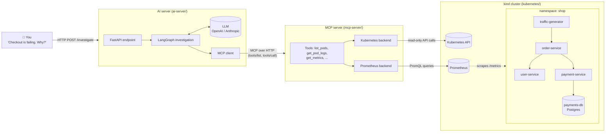

There are two separate applications, deliberately kept apart:

| | MCP server | AI server |
| --- | --- | --- |
| Job | Knows how to *look at* the system (Kubernetes, Prometheus) | Knows how to *think* about an incident (LLM + investigation steps) |
| Knows about the LLM? | No | Yes |
| Knows about Kubernetes? | Yes | No: it only sees "tools" |
| Talks to the other via | MCP over HTTP | MCP over HTTP |

That split is the point of MCP (Model Context Protocol). The AI side discovers
whatever tools the MCP server offers at runtime. You could point it at a
different MCP server (GitHub, a database…) without changing AI code.

---

## 2. Words you need

| Word | Plain meaning | Where in this repo |
| --- | --- | --- |
| **LLM** | The language model (GPT, Claude) that reads text and writes text | `ai-server/agent/chat_model.py` |
| **MCP** | A standard protocol for giving an LLM app *tools*. A **server** offers tools; a **client** lists and calls them | `mcp-server/`, `ai-server/mcp_client/` |
| **Tool** | A function the agent can call, with a name, a description and a JSON schema for its arguments | `mcp-server/tools/` |
| **LangChain** | A library that gives every LLM provider the same Python interface | `init_chat_model(...)` |
| **LangGraph** | A library for writing an AI workflow as a **graph** of steps (nodes) sharing a **state** | `ai-server/agent/graph.py` |
| **Kubernetes (k8s)** | Runs containers. A **Pod** is a running container; a **Deployment** keeps N pods of a service running; a **ReplicaSet** is one version of a Deployment; a **Service** gives pods a stable DNS name | `kubernetes/` |
| **kind** | "Kubernetes in Docker": a whole cluster on your laptop | `kubernetes/kind-cluster.yaml` |
| **Prometheus** | Collects numbers ("metrics") from services every few seconds and answers queries | `kubernetes/monitoring/` |
| **PromQL** | Prometheus' query language, e.g. `rate(http_requests_total[30s])` | `mcp-server/observability/queries.py` |
| **RBAC** | Kubernetes permissions: which identity may read or change which resources | `kubernetes/base/rbac/` |
| **Evidence** | One tool call plus its result, as kept by the agent | `ai-server/agent/models.py` |
| **Scenario** | A deliberately injected incident, used to test the agent | `kubernetes/scenarios/`, `evals/` |

---

## 3. Map of the repository

```text
ai-oncall-agent/
├── sample-services/          ← the fake "production" apps that will break
│   ├── order-service/        ←   POST /orders: calls user-service, then payment-service
│   ├── user-service/         ←   GET /users/{id}            (fault: burns CPU)
│   ├── payment-service/      ←   POST /payments → Postgres  (faults: errors, slowness)
│   └── requirements-dev.txt
├── kubernetes/
│   ├── kind-cluster.yaml     ← local cluster definition (+ Prometheus port on 127.0.0.1:9090)
│   ├── base/                 ← the HEALTHY system (kustomize)
│   │   ├── deployments/      ←   one Deployment per service + payments-db + traffic-generator
│   │   ├── services/         ←   stable DNS names (http://payment-service)
│   │   ├── configmaps/       ←   settings (URLs, DB host)
│   │   ├── secrets/          ←   *.env.example → generated *.env (gitignored)
│   │   └── rbac/             ←   read-only identity for the MCP server, discovery for Prometheus
│   ├── scenarios/            ← six INCIDENTS, each a small patch on top of base/
│   └── monitoring/           ← Prometheus (own namespace) + its scrape config
├── mcp-server/               ← the agent's EYES (MCP server)
│   ├── server.py             ←   creates the MCP server and registers the tools
│   ├── tools/                ←   what the agent may call (+ guards: allowlists, validation)
│   ├── cluster/              ←   Kubernetes backends: real + fake, same interface
│   ├── observability/        ←   Prometheus backends: real + fake; all PromQL in queries.py
│   ├── data/fake_cluster.py  ←   canned incident for tests and `make up`
│   └── config/settings.py
├── ai-server/                ← the agent's BRAIN
│   ├── main.py               ←   FastAPI app + error → HTTP status mapping
│   ├── api/                  ←   routes, request/response schemas, dependencies
│   ├── mcp_client/           ←   connect to the MCP server; MCP tool → LangChain tool
│   ├── agent/                ←   the investigation: graph, evidence rules, prompts, models
│   └── config/settings.py
├── evals/                    ← scenario definitions, eval runner, replay tool
├── docker-compose.yml        ← AI + MCP server in Docker (fake data)
├── docker-compose.kind.yml   ← overlay: MCP server reads the real cluster
├── Makefile                  ← every command (`make help`)
├── CODING_GUIDELINES.md      ← the rules the code follows
└── PLAN.md                   ← the phase-by-phase roadmap
```

**Rule of thumb:** `sample-services` + `kubernetes` are the *patient*,
`mcp-server` is the *stethoscope*, `ai-server` is the *doctor*, `evals` is the
*exam*.

---

## 4. One investigation, end to end

Here is everything that happens when you send
`POST /investigate {"question": "Checkout errors started a few minutes ago"}`:

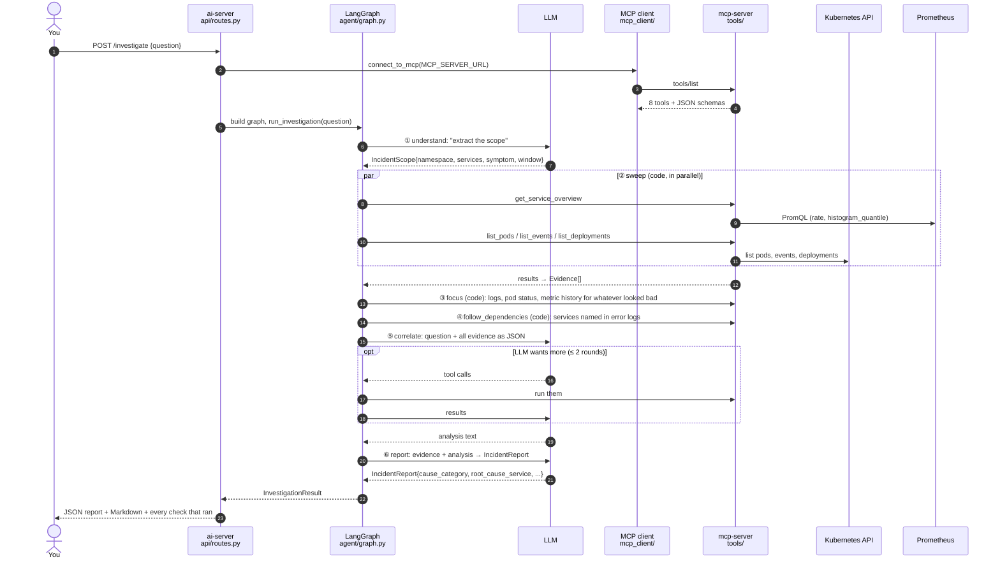

Key point: **only steps ①, ⑤ and ⑥ use the LLM.** Steps ②–④ are ordinary
Python that decides which tools to call based on what earlier calls returned.
That's why the agent is reliable (the important checks always happen) and
cheap (about 3 LLM calls per investigation).

---

## 5. The code, folder by folder

### 5.1 sample-services: the "production" system

Three small FastAPI apps. They exist so there's something real to break.

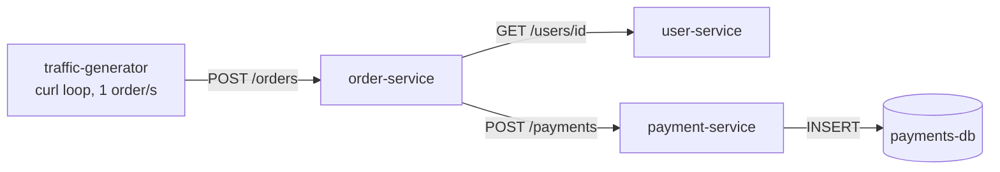

**order-service** (`sample-services/order-service/main.py`) is the front door.
It calls the other two services through one helper, `call_downstream`:

```python
async def call_downstream(http_client, method, url, **kwargs) -> dict:
    started = time.monotonic()
    try:
        response = await http_client.request(method, url, **kwargs)
    except httpx2.HTTPError as error:
        raise upstream_failure(f"upstream unavailable: {method} {url} ({error!r})")
    elapsed = time.monotonic() - started
    if elapsed >= settings.slow_call_warning_seconds:
        logger.warning(f"slow upstream call: {method} {url} took {elapsed:.2f}s")
    ...
    if response.is_error:
        raise upstream_failure(f"upstream error {response.status_code}: {method} {url}")
```

- **What it does:** makes the call, and if it fails or is slow, writes a log
  line that **names the dependency and URL**.
- **Why it matters for the agent:** a bare `502 Bad Gateway` in a log tells you
  nothing. `upstream unavailable: POST http://payment-service/payments` tells
  the agent exactly where to look next. Section 7 shows this clue driving the
  investigation.

**payment-service** (`sample-services/payment-service/`) stores each payment
in Postgres through a small "store" interface (`store.py`), so tests can swap
in an in-memory store:

```python
def save(self, payment_id, order_id, amount, provider) -> None:
    try:
        with psycopg.connect(**self._connection_args) as connection:
            connection.execute(CREATE_TABLE)          # every time, so an emptied DB recovers
            connection.execute(INSERT_PAYMENT, (payment_id, order_id, amount, provider))
    except psycopg.OperationalError as error:
        raise DatabaseUnavailable(f"database unavailable: {self._address} ({error})")
```

`main.py` turns `DatabaseUnavailable` into **HTTP 503** and logs
`database unavailable: payments-db:5432 (...)`. That's the clue for the
db-down scenario.

**Fault injection.** Each service has a `FAULT_MODE` setting, `none` by
default. Only scenario overlays switch it on:

```python
def inject_fault() -> None:              # payment-service
    if settings.fault_mode == "latency":
        time.sleep(settings.fault_latency_seconds)   # 3s: the slow-payments scenario
    if settings.fault_mode == "error":
        raise KeyError("currency")                   # the bad-deploy "v2 regression"
```

```python
def burn_cpu(milliseconds: int) -> None:  # user-service, FAULT_MODE=cpu
    deadline = time.process_time() + milliseconds / 1000
    while time.process_time() < deadline:
        digest = hashlib.sha256(digest).digest()
```

**Observability in every service:**

- `Instrumentator(...).instrument(app, latency_lowr_buckets=LATENCY_BUCKETS_SECONDS).expose(app)`
  adds a `/metrics` endpoint with request counts (`http_requests_total`) and a
  latency histogram (`http_request_duration_seconds`). The buckets go up to
  10s, because a percentile can never be higher than the top bucket (see §11).
- `ProbeAccessLogFilter` keeps `/health` and `/metrics` out of the access log,
  so real traffic isn't buried under probe noise.
- `/health` is used by Kubernetes probes.

### 5.2 kubernetes: where everything runs

**kustomize** builds the YAML: `base/` is the healthy system, and each
`scenarios/<name>/` is a small patch on top of it.

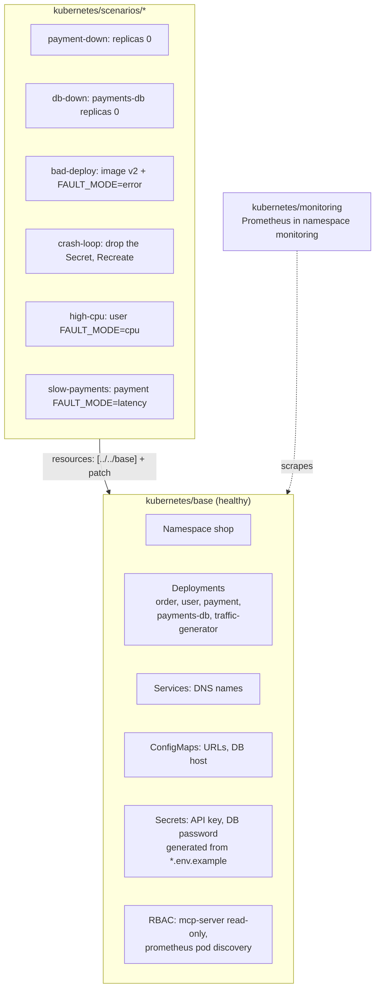

What a typical Deployment declares (`base/deployments/payment-service.yaml`):

- `replicas: 2`, so two pods; `labels: app, version`, which the agent uses to
  group pods.
- `annotations: prometheus.io/scrape: "true"`, which tells Prometheus to scrape
  this pod.
- `envFrom:` its ConfigMap and Secrets, so configuration lives outside the code.
- Probes (`/health`), CPU/memory **requests and limits**, a non-root user, a
  read-only filesystem.

`monitoring/prometheus.yml` has two scrape jobs:

- `shop-pods`: every pod in `shop` that opted in. It adds the labels
  `service`, `version` and `pod`.
- `kubelet-cadvisor`: CPU **throttling** per container, which average CPU
  hides (see the high-cpu scenario).

### 5.3 mcp-server: the agent's eyes

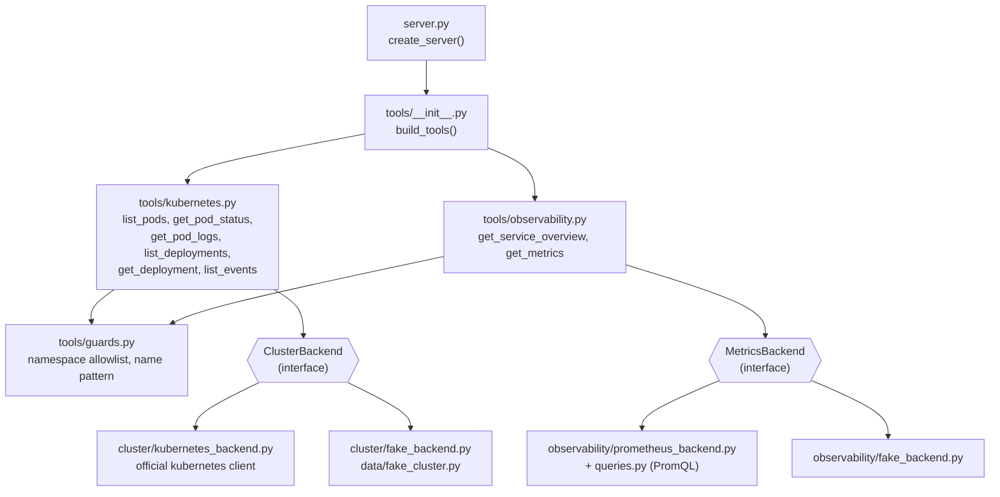

**`server.py`** creates the MCP server and registers every tool:

```python
def create_server(settings, cluster=None, metrics=None) -> MCPServer:
    server = MCPServer(settings.server_name, version=settings.server_version, ...)
    tools = build_tools(cluster or create_backend(settings), metrics or create_metrics_backend(settings), settings)
    for tool in tools:
        server.add_tool(tool)
```

- `MCP_BACKEND=kubernetes` (default) → real backends; `fake` → canned data
  (used by tests and `make up`).
- `cluster=` and `metrics=` let tests inject fakes.

**A tool is just a typed Python function.** From `tools/kubernetes.py`:

```python
def get_pod_logs(
    pod: str,
    namespace: Namespace = settings.default_namespace,
    lines: Annotated[int, Field(ge=1, le=MAX_LOG_LINES, description="Recent lines to return")] = DEFAULT_LOG_LINES,
    previous: Annotated[bool, Field(description="Logs of the previous (crashed) container ...")] = False,
) -> PodLogs:
    """Recent log lines of a pod (newest last), each starting with its timestamp. ..."""
    require_allowed(namespace)
    return PodLogs(namespace=namespace, pod=pod, previous=previous,
                   lines=backend.get_pod_logs(namespace, pod, lines, previous))
```

- **The MCP SDK turns this signature into a JSON Schema** (`lines` gets
  `minimum: 1, maximum: 500`), and **the docstring becomes the description the
  LLM reads.** Writing good docstrings *is* prompt engineering.
- `require_allowed(namespace)` rejects anything outside `MCP_ALLOWED_NAMESPACES`.
- The return type `PodLogs` (a pydantic model) becomes the tool's **output
  schema**, and only the chosen fields are returned (never env vars or secrets).

**Errors written for the model.** `cluster/kubernetes_backend.py` translates
Kubernetes API errors into messages the LLM can act on:

```python
except ApiException as error:
    if error.status == 404: raise ClusterError(f"Not found: {action} in namespace '{namespace}'")
    if error.status == 403: raise ClusterError(f"Forbidden by RBAC: the MCP server may not {action} ...")
```

and for logs: *"Pod 'x' has no previous (crashed) container… Call get_pod_logs
again with previous=false."* A good error tells the model what to do next.

**PromQL lives in one place,** `observability/queries.py`. For example, error
rate:

```python
case "error_rate":
    numerator = f"sum(rate(http_requests_total{{...,status=\"5xx\"}}[{window}]))"
    return f"({numerator} or vector(0)) / sum(rate(http_requests_total{{...}}[{window}]))"
```

which, for payment-service, becomes:

```promql
(sum(rate(http_requests_total{namespace="shop",service="payment-service",status="5xx"}[30s])) or vector(0))
  / sum(rate(http_requests_total{namespace="shop",service="payment-service"}[30s]))
```

Metric history results (`MetricSeries`) also carry `latest`, `min` and `max`,
so the LLM doesn't have to read raw arrays to tell "still happening" from
"spiked earlier".

### 5.4 ai-server: the agent's brain

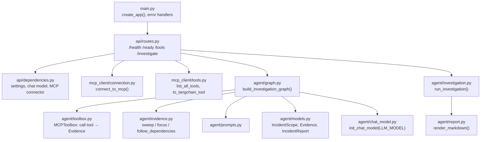

**`agent/chat_model.py`:** one function, provider-agnostic:

```python
return init_chat_model(settings.llm_model, timeout=..., max_retries=..., api_key=...)
# LLM_MODEL=openai:gpt-5.4-mini  or  anthropic:claude-opus-5 ; nothing else changes
```

**`mcp_client/connection.py`:** opens an MCP session. One subtlety:
`mcp.Client` wraps every error in an `ExceptionGroup`, so `connect_to_mcp`
unwraps it and turns network failures into `MCPUnavailableError`, which
becomes HTTP 503.

**`agent/toolbox.py`:** how the code calls tools:

```python
async def call(self, name, arguments, step) -> Evidence:
    try:
        result = await self._client.call_tool(name, arguments)
    except Exception as error:
        return Evidence(source=name, arguments=arguments, error=f"MCP call failed: {error}", step=step)
    ...
    return Evidence(source=name, arguments=arguments, result=_parse(text), step=step)
```

- **It never raises.** A failed check becomes evidence with an `error`,
  because "I couldn't read the logs" is information too.

**`agent/evidence.py`:** the deterministic investigator. This is the most
important file to understand.

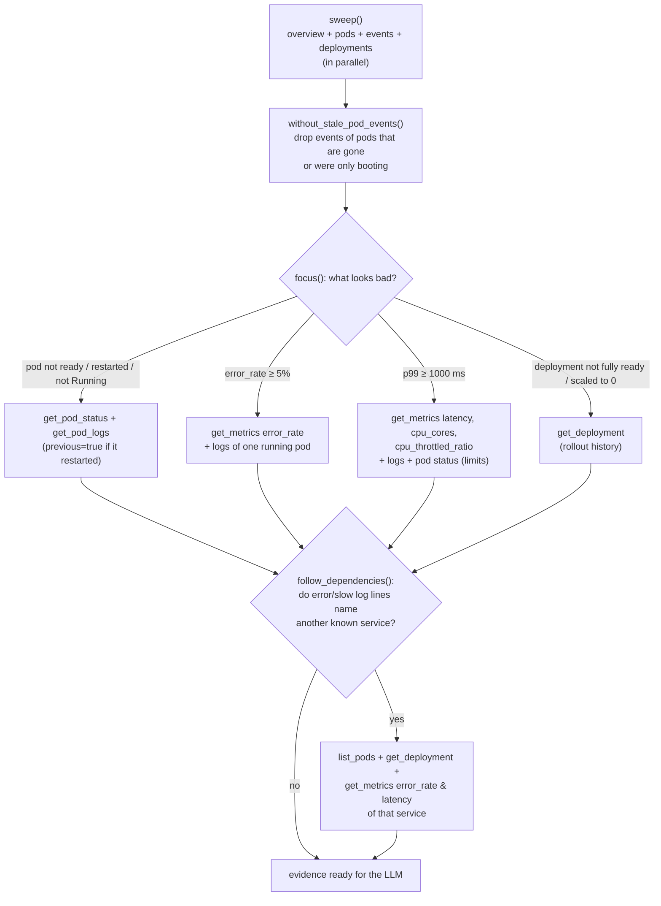

Some of the actual rules:

```python
def unhealthy_pods(pods):
    return [p for p in pods if not p.get("ready") or p.get("restarts", 0) > 0 or p.get("status") != "Running"]

def failing_services(services, threshold):          # ERROR_RATE_THRESHOLD = 0.05
    return [s["service"] for s in services if (s.get("error_rate") or 0) >= threshold]

def slow_services(services, threshold_ms):          # LATENCY_THRESHOLD_MS = 1000
    return [s["service"] for s in services if (s.get("latency_p99_ms") or 0) >= threshold_ms]
```

And how it finds dependencies in logs:

```python
FAILED_CALL_HINTS = ("upstream", "slow", "unavailable", "connection refused", "connecterror", ...)

def upstream_services(evidence, known_services):
    for line in log_lines:
        if any(hint in line.lower() for hint in FAILED_CALL_HINTS):
            found |= _service_names_in(line, known_services) - own   # e.g. {"payments-db"}
```

- `known_services` are the deployment names, so random words never count.
- `own` removes the pod's own service (a payment-service log mentioning
  payment-service isn't a dependency).

**`agent/graph.py`:** wires everything into a LangGraph state machine:

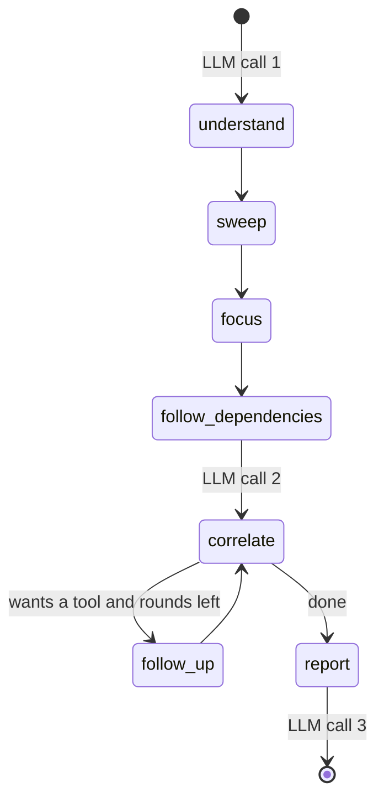

The **state** passed between nodes is a dictionary (`InvestigationState`).
Lists like `evidence` and `notes` use `operator.add`, so each node *appends*
to them:

```python
class InvestigationState(TypedDict):
    question: str
    scope: IncidentScope | None
    evidence: Annotated[list[Evidence], operator.add]   # every node adds its findings
    notes: Annotated[list[str], operator.add]           # "skipped X", "logs point at Y"
    messages: Annotated[list[BaseMessage], add_messages] # the correlate conversation
    follow_up_rounds: int
    report: IncidentReport | None
    ...
```

**`api/routes.py`:** puts it together per request:

```python
async with open_mcp() as mcp_client:
    tools = await list_all_tools(mcp_client)                      # MCP discovery
    graph = build_investigation_graph(chat_model, MCPToolbox(mcp_client, tools),
                                      [to_langchain_tool(mcp_client, t) for t in tools], settings)
    result = await run_investigation(graph, request.question, settings.max_follow_up_rounds)
```

Two kinds of tool access:
- `MCPToolbox` is used by **code** in the fixed steps.
- `to_langchain_tool` wraps the same MCP tools for the **LLM**, used during
  `correlate` follow-ups.

### 5.5 evals: grading the agent

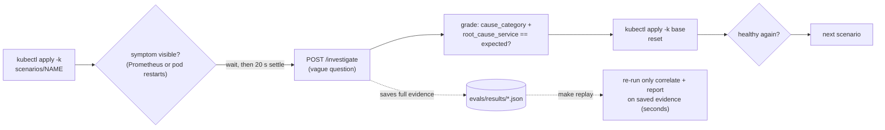

- `evals/scenarios.py` holds, for each scenario, the question, the symptom to
  wait for, and the expected answer.
- `evals/run_eval.py` is the loop above (standard library only).
- `evals/replay.py` re-runs only the LLM reasoning on saved evidence, so prompt
  changes can be tested in seconds and repeated (`TIMES=5`), since LLM answers
  vary.

### 5.6 Makefile and configuration

Every command is a `make` target (`make help`). The main ones:

| Command | What happens |
| --- | --- |
| `make setup` | virtualenv per app + dependencies + `ai-server/.env` |
| `make cluster-up` | kind cluster → build and load images → apply `monitoring/` and `base/` → wait → `mcp-kubeconfig` |
| `make run-mcp-server` / `make run-ai-server` | run both servers locally |
| `make scenario NAME=db-down` / `make scenario-reset` | break / heal |
| `make eval`, `make replay` | grade the agent |
| `make cluster-down` | delete the cluster |

**Configuration** never lives in code: each app has `config/settings.py`
(pydantic-settings) that reads environment variables or `.env`. Examples:
`LLM_MODEL`, `ERROR_RATE_THRESHOLD`, `MCP_ALLOWED_NAMESPACES`,
`MCP_PROMETHEUS_URL`. Each `.env.example` documents every setting.

---

## 6. How the LLM gets context and reasons

The LLM is called **three times**, each with a narrow job and a typed output
where code needs one.

### Call #1: understand (structured output → `IncidentScope`)

- **Input:** `UNDERSTAND_PROMPT` + your question.
- **Output (forced shape):**

```json
{"namespace": null, "suspected_services": [], "symptom": "checkout errors", "window_minutes": 15}
```

- `chat_model.with_structured_output(IncidentScope)` makes the LLM return
  exactly this pydantic model, so code can use it safely.
- The prompt says "product words like 'checkout' are not service names", so it
  doesn't invent services.

### Between calls #1 and #2: code gathers the context

The LLM doesn't choose the basic checks. `sweep`, `focus` and
`follow_dependencies` do, as described in §5.4.

### Call #2: correlate (free text, may request tools)

This is **everything the LLM sees** (built by `correlation_messages()` in
`graph.py`). Below is a shortened, illustrative example from the db-down
scenario:

```text
SYSTEM: You are an on-call engineer investigating a production incident. Evidence has
already been gathered ... Follow the dependency chain ... Explain what is happening NOW.
Compare log and event timestamps with the current time, and a metric's `latest` value
with its `max` ... If a specific piece of evidence is missing ... call a tool ...

HUMAN:
Current time (UTC): 2026-09-28T16:40:12+00:00
Incident report: Checkout errors started a few minutes ago. What is going on?
Understood scope: {"namespace":null,"suspected_services":[],"symptom":"checkout errors","window_minutes":15}
Namespace: shop
Evidence: [
 {"step":"sweep","source":"get_service_overview","result":{"services":[
    {"service":"order-service","error_rate":0.71,"latency_p99_ms":120},
    {"service":"payment-service","error_rate":1.0,"latency_p99_ms":2100},
    {"service":"user-service","error_rate":0.0,"latency_p99_ms":45}]}},
 {"step":"sweep","source":"list_pods","result":{"pods":[ ...all Running, ready... ]}},
 {"step":"sweep","source":"list_deployments","result":{"deployments":[
    {"name":"payments-db","desired_replicas":0,"ready_replicas":0}, ...]}},
 {"step":"focus","source":"get_pod_logs","arguments":{"pod":"payment-service-7f..."},
  "result":{"lines":["2026-09-28T16:39:58Z ERROR: database unavailable: payments-db:5432 (connection refused)", ...]}},
 {"step":"focus","source":"get_pod_logs","arguments":{"pod":"order-service-5b..."},
  "result":{"lines":["2026-09-28T16:39:59Z ERROR: upstream error 503: POST http://payment-service/payments", ...]}},
 {"step":"follow_dependencies","source":"list_pods","arguments":{"app":"payments-db"},"result":{"pods":[]}},
 ...
]
```

The LLM then reasons, for example: *"order-service fails because
payment-service returns 503; payment-service logs say the database refuses
connections; payments-db has 0 replicas and no pods. Root cause: payments-db
is down."*

**If something is missing,** the LLM can call tools (bound via
`bind_tools(tools)`). The graph runs them (`follow_up`), adds the results to the
evidence, and asks again, at most `MAX_FOLLOW_UP_ROUNDS` times.

### Call #3: report (structured output → `IncidentReport`)

- **Input:** `REPORT_PROMPT` + question + evidence + the analysis from call #2
  + notes.
- **Output (forced shape):**

```json
{
  "incident": "Checkout failing: payment-service cannot reach its database",
  "cause_category": "dependency_unavailable",
  "root_cause_service": "payments-db",
  "impact": "All orders fail with 502",
  "evidence": [{"source": "get_pod_logs", "finding": "payment-service: 'database unavailable: payments-db:5432'"}],
  "likely_cause": "payments-db is scaled to 0 ...",
  "confidence": "high",
  "recommended_actions": ["Scale payments-db back to 1 replica", "..."],
  "timeline": ["16:38 payments-db scaled to 0", "16:39 payment-service 503s begin"]
}
```

`cause_category` is chosen **by mechanism, in a fixed order**. That rule
came from a real failure (see §11):

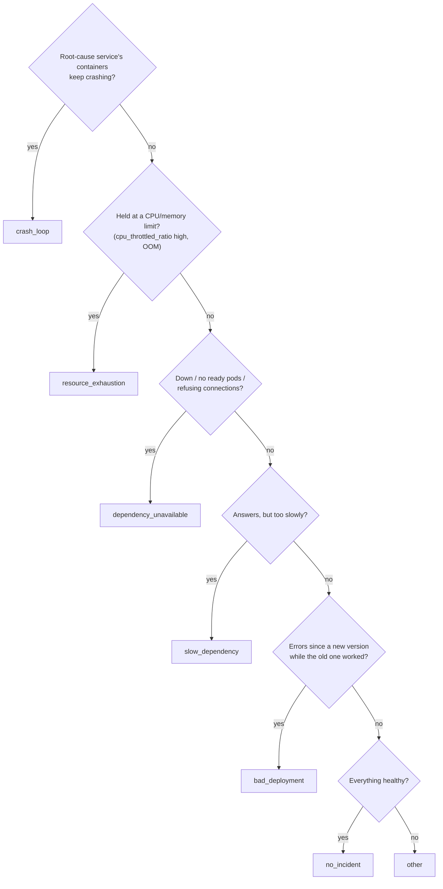

### What makes the context *good* (all learned the hard way)

| Problem | What the code does about it |
| --- | --- |
| Old incidents look current | Events of pods that no longer exist are dropped; logs have timestamps; the LLM gets the current time; metrics include `latest` vs `max` |
| Pods booting cause "connection refused" probe events | Probe failures of pods that are now ready are dropped (`without_stale_pod_events`) |
| Raw API objects are huge and noisy | Tools return small typed models with only the useful fields |
| Average CPU hides throttling | `cpu_throttled_ratio` from cAdvisor + the container's `cpu_limit` |
| Logs flooded by probes and scrapes | `ProbeAccessLogFilter` in every service |
| A bare 502 says nothing | Services log the failing or slow dependency URL |

---

## 7. Every scenario, step by step

For each scenario: what breaks, what the system shows, which code notices it,
and how the LLM concludes. You can trigger any of them with
`make scenario NAME=<name>`.

### 7.1 payment-down: a dependency has no pods

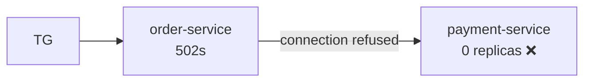

- **Break:** `scenarios/payment-down` patches `replicas: 0`.
- **Signals:** order-service `error_rate` about 0.7; payment-service is
  **missing** from the overview (no pods means no metrics);
  `list_deployments` shows payment-service `desired_replicas: 0`.
- **Code:**
  - `focus`: order-service is failing → error-rate history + its logs
    (`upstream unavailable: POST http://payment-service/payments (ConnectError…)`).
  - payment-service is a `troubled_deployment` (desired 0) → `get_deployment`.
  - `follow_dependencies`: the log names payment-service → `list_pods app=payment-service` → **empty**.
- **LLM:** "payment-service has no pods; order-service fails calling it" →
  `dependency_unavailable / payment-service`.

### 7.2 db-down: two hops from the symptom

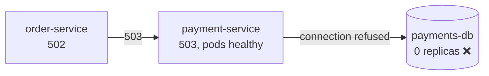

- **Break:** `payments-db` replicas 0.
- **Signals:** **both** order-service and payment-service fail; all their pods
  look healthy.
- **Code:**
  - `focus`: both are failing services → logs from one running pod of each.
    payment-service: `database unavailable: payments-db:5432`.
  - `troubled_deployments` includes payments-db (desired 0).
  - `follow_dependencies` finds `payments-db` in the error line (not a URL!) →
    `list_pods app=payments-db` → empty.
- **LLM:** follows the chain order → payment → database. **Root cause is the
  database**, even though no user ever talks to it →
  `dependency_unavailable / payments-db`.

### 7.3 bad-deploy: the new version is broken

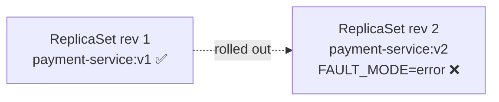

- **Break:** image `v2`, label `version: v2`, `FAULT_MODE=error`. Pods start
  fine, but every payment returns 500 (`KeyError: 'currency'`).
- **Signals:** payment-service `error_rate` = 1.0; pods Running and ready; the
  rollout is recent.
- **Code:**
  - `focus`: payment-service is failing → logs (with the traceback).
  - `get_deployment` → revisions: rev 2 (v2) is current, rev 1 (v1) was fine.
- **LLM:** reachable, not crashing, not limited, not slow, but errors began
  with the new version → `bad_deployment / payment-service`. Recommends a
  rollback.

### 7.4 crash-loop: it can't even start

- **Break:** the overlay removes the Secret holding `PAYMENT_API_KEY` and uses
  `strategy: Recreate`. pydantic-settings then fails at startup, so every pod
  crashes.
- **Signals:** pods in `CrashLoopBackOff`, restarts climbing; `BackOff` events.
- **Code:**
  - `unhealthy_pods` catches them → `get_pod_status` (`last_exit_code: 1`) and
    `get_pod_logs previous=true`, the logs of the **crashed** container, which
    show the validation error about the missing `payment_api_key`.
- **LLM:** containers keep crashing → `crash_loop / payment-service`, the first
  category in the precedence order.

### 7.5 high-cpu: slow, but not because of a dependency

- **Break:** user-service `FAULT_MODE=cpu`: 800 ms of CPU per request against
  a 250m CPU limit.
- **Signals:** user-service and order-service p99 about 4–5 s. **Average CPU
  looks low** (traffic is bursty), but `cpu_throttled_ratio` is about 0.6–0.8:
  the container spends most of its time held at its limit.
- **Code:**
  - `focus`: both services are `slow_services` (p99 ≥ 1000 ms) → `latency_p99_ms`,
    `cpu_cores`, `cpu_throttled_ratio` + `get_pod_status`, whose
    `cpu_limit: "250m"` comes from the container spec.
- **LLM:** order-service is slow because user-service is slow, and user-service
  is CPU-throttled → `resource_exhaustion / user-service` (it outranks
  `slow_dependency`).

### 7.6 slow-payments: slow, and nothing is starved

- **Break:** payment-service `FAULT_MODE=latency`: sleeps 3 s per request.
- **Signals:** order-service p99 about 4.5 s, **no errors**. order-service logs
  `slow upstream call: POST http://payment-service/payments took 3.02s`.
  payment-service p99 about 3 s, and it isn't throttled.
- **Code:**
  - `focus`: order-service is slow → its logs carry the slow-call line.
  - `follow_dependencies`: "slow" is a hint → payment-service named → its
    `error_rate` (0) and `latency_p99_ms` (high) are fetched.
- **LLM:** answers correctly but slowly, with no resource limit hit →
  `slow_dependency / payment-service`. The rollout that enabled the fault is
  mentioned, but "a preceding rollout doesn't make it `bad_deployment`".

### 7.7 Healthy system and other edge cases

| Situation | What happens |
| --- | --- |
| Nothing is wrong | `focus` finds nothing → note "nothing flagged by the sweep" → `no_incident` |
| A tool is missing (e.g. no metrics server) | `_call_all` skips it and notes "skipped get_service_overview" |
| A tool fails (RBAC, no previous container…) | Kept as evidence with `error`; the LLM reads the message |
| The LLM keeps asking for tools | Stopped after `MAX_FOLLOW_UP_ROUNDS`; the response says `follow_up_limit_reached: true` |
| MCP server down | HTTP **503** from the AI server |
| LLM provider down / bad key | HTTP **502**, a generic message; details only in the server log |
| Question asks about `kube-system` | Tools refuse (namespace allowlist), and RBAC would also refuse |

---

## 8. Security: who may do what

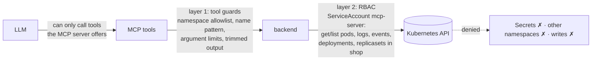

- **Layer 1, code** (`mcp-server/tools/guards.py`): `NAME_PATTERN` stops PromQL
  injection (`x",namespace="kube-system` is rejected), and the namespace
  allowlist applies to every tool.
- **Layer 2, Kubernetes RBAC** (`kubernetes/base/rbac/mcp-server.yaml`): even
  buggy code can't read Secrets or delete pods. `tests/integration/test_kind_cluster.py`
  proves this with real 403s.
- **Credentials:** `make mcp-kubeconfig` creates a **24h token** for that
  ServiceAccount, never your admin kubeconfig. LLM keys live only in the
  gitignored `.env`.

---

## 9. How it is tested

| Level | Where | What it proves |
| --- | --- | --- |
| Unit, sample services | `sample-services/*/tests/` | endpoints, faults, metrics, logs |
| MCP protocol | `mcp-server/tests/test_server.py` | tools via a real MCP `Client` in-process: schemas, allowlist, errors |
| Backends | `test_kubernetes_backend.py`, `test_prometheus_backend.py` | mapping and error translation with stubbed APIs |
| Investigation | `ai-server/tests/test_investigation.py` | each graph step, with a **fake MCP server** and a **scripted LLM** |
| API | `ai-server/tests/test_api.py` | response shapes, 502/503 mapping |
| Integration | `*/tests/integration/` | real HTTP transport; the live cluster (auto-skipped without one) |
| Agent quality | `make eval` / `make replay` | does it find the right root cause? (6/6) |

The scripted LLM (`ai-server/tests/fakes.py::ScriptedChatModel`) returns
pre-written answers, so graph tests are fast, free and deterministic.

---

## 10. Try it yourself

```bash
make setup                       # once
make cluster-up                  # ~2 min
make run-mcp-server              # terminal 1
make run-ai-server               # terminal 2

curl -s localhost:8000/tools     # what the agent can do
make scenario NAME=db-down       # break something
curl -s -X POST localhost:8000/investigate -H "content-type: application/json" \
     -d '{"question": "Checkout errors started a few minutes ago. What is going on?"}'
make scenario-reset              # heal
make cluster-down                # free your laptop
```

Exercises that teach the most:

1. **Watch the evidence.** Add `"include_evidence_results": true` to the
   request and read what each step collected.
2. **Write a PromQL query** from §5.3 in the Prometheus UI at
   `http://127.0.0.1:9090`.
3. **Change a prompt**, then `make replay NAME=slow-payments TIMES=5` and see
   whether it still passes.
4. **Add a tool** (e.g. `get_service_endpoints`): a function in
   `mcp-server/tools/kubernetes.py`, an RBAC rule, a test. The AI server picks
   it up automatically through `tools/list`.
5. **Add a scenario:** an overlay in `kubernetes/scenarios/`, plus an entry in
   `evals/scenarios.py`.

---

## 11. Lessons learned (and the bugs behind them)

Each of these was found by running real scenarios, not by unit tests:

| Symptom | Real cause | Fix |
| --- | --- | --- |
| Agent skipped logs, missed the cause | Free-form agent chose tools badly | Deterministic `sweep → focus → follow_dependencies` (Phase 8) |
| "502" with no clue | Services didn't log *which* dependency failed | `upstream unavailable: <url>` / `slow upstream call` log lines |
| payment-service never recovered after the DB restart | Table created only once per process | `CREATE TABLE IF NOT EXISTS` on every connection |
| p99 stuck at exactly 1000 ms | Default histogram buckets stopped at 1 s | Buckets up to 10 s |
| "CPU is fine" while requests took 3.4 s | Average CPU hides throttling | cAdvisor `cpu_throttled_ratio` + container limits |
| Old incident blamed for a new one | Stale events/logs, no timestamps | Drop events of gone pods, timestamped logs, current time, `latest` vs `max` |
| Logs were one giant string | Kubernetes client returned a bytes repr | Read the raw response and decode it |
| A config rollout called `bad_deployment` | Ambiguous categories | Mechanism-first precedence order |

**The big lesson:** when the agent is wrong, look at the **evidence** first.
Most failures were missing or misleading evidence, not bad reasoning.
