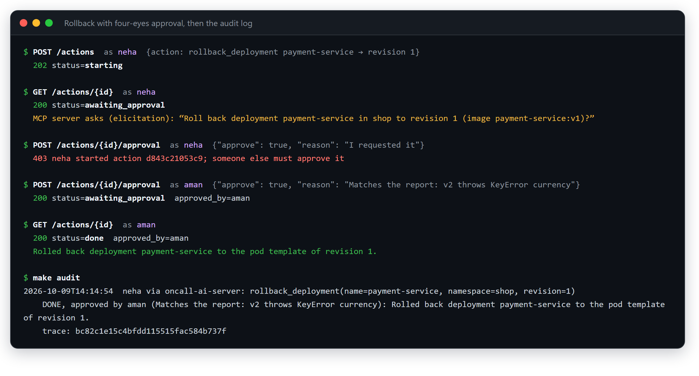

# Changes, security and the gateway

An agent that only reads is helpful. An agent that can also *fix* things is much more helpful, and
much scarier. This page covers how the agent is allowed to change production without anyone
losing sleep: a human approves every change, a second person signs off, everyone signs in, and
every action is written down.

## Fixes need a human's approval

The agent can **suggest** a fix in its report, for example "roll payment-service back to
revision 1". It can't run it on its own. Running it goes like this:

1. Someone asks for the fix (`POST /actions`).
2. The MCP server checks that the fix makes sense: the deployment exists, the revision exists,
   the replica count is within limits.
3. The server **stops and asks a human**: "Roll back deployment payment-service in shop to
   revision 1 (image payment-service:v1)?"
4. A person approves or rejects it, with a reason.
5. If approved, the change is made. If it's rejected, declined, or nobody answers in time,
   nothing changes, and the result says so.

```text
POST /investigate  → report.proposed_actions: [{"operation": "rollback_deployment",
                      "deployment": "payment-service", "revision": 1, "reason": "..."}]
POST /actions {"action": <one proposed action>}         → {"id": "53c3…", "status": "starting"}
GET  /actions/53c3…  → {"status": "awaiting_approval", "question": "Roll back deployment payment-service ...?"}
POST /actions/53c3…/approval {"approve": true, "reason": "v2 breaks payments"}
GET  /actions/53c3…  → {"status": "done", "result": {"detail": "Rolled back deployment ..."}}
```

The question in step 3 is MCP **elicitation**: the server asking the client for input from a
human. Because the server asks, a client that can't reach a human can't make a change at all.

What the agent can change, and nothing else:

| Tool | What it does |
| --- | --- |
| `restart_deployment` | Restarts all pods of a deployment |
| `scale_deployment` | Sets the number of pods (between 0 and `MCP_MAX_REPLICAS`) |
| `rollback_deployment` | Goes back to an earlier version, like `kubectl rollout undo` |

These tools are off unless `MCP_ENABLE_WRITE_TOOLS=true`, they're labelled destructive so the
investigating agent never sees them, and they run under a **separate Kubernetes account** that may
only patch deployments in `shop`. The read-only account still can't change anything.

The eval also grades the suggested fixes: for payment-down and db-down the right fix is to scale
back up, and for bad-deploy it's a rollback.

**In the code:** `mcp-platform/server/k8s/deployments.py` (the tools and the approval question),
`ai-server/actions/` (waiting for the approval), `mcp-platform/server/deploy/mcp-operator.yaml`
(the separate account).

## Who may do what

Before this, anyone who could reach the MCP server could call any tool, and approving a change was
just a click anyone could make. Now every request says **who** is asking, their role decides
**what** they may do, and everything lands in an **audit log**.

```text
person ──API key──► AI server ──signed token: "this is aman, may read + write, valid 60 s"──► gateway ──► MCP server
                                                                                                ├ 401 without a valid token
                                                                                                ├ is aman's role allowed this tool?
                                                                                                └ audit log: who, what, approved by whom, trace
```

- **Signing in.** Every person has an API key (`X-API-Key` header). Everything except `/health` and
  `/ready` needs one. With no keys configured, sign-in is off, which is for local development only.
- **Tokens to the MCP servers.** For every request, the AI server creates a short-lived token (60
  seconds) saying who the signed-in person is and what they may do, signed with a private key.
  The gateway and the servers check it with the matching public key. Without a valid token the
  answer is 401.
- **Scopes.** An investigation's token only allows reading, so the write tools don't even appear
  in its tool list. Only `POST /actions` gets a token that allows writing.
- **Roles.** Everyone may read. Beyond that:

  | Role | May also |
  | --- | --- |
  | `developer` | nothing (read only) |
  | `oncall` | restart and scale |
  | `lead` | restart, scale and roll back |

- **Four eyes.** The person who asks for a change can't approve it. The AI server refuses that
  with a 403, and the MCP server checks again: the approver must be someone else whose role allows
  that tool.
- **Audit log.** Every tool call is written to an append-only file, one per MCP server: who asked,
  through which agent, with what arguments, what happened, who approved it and why, and a link to
  the Langfuse trace. So "who rolled back payment-service at 2 a.m., and why?" has a one-line
  answer.

```text
$ make audit DEPLOYMENT=payment-service SINCE=24
2026-10-04T06:47:31  ravi via oncall-ai-server: rollback_deployment(name=payment-service, namespace=shop, revision=1)
    REFUSED: Access denied: role oncall may not call rollback_deployment
2026-10-04T06:47:35  aman via oncall-ai-server: rollback_deployment(name=payment-service, namespace=shop, revision=1)
    DONE, approved by neha (v2 breaks payments): Rolled back deployment payment-service to the pod template of revision 1.
    trace: https://cloud.langfuse.com/project/<project>/traces/939a4752684ff891ec3a3bf20e4008d7
```

Here's the whole flow from the real demo: the request, the approval question, the requester's own
approval refused, a second person approving it, and the audit entry.

<p align="center"></p>

**Setup:** `make mcp-keys` creates the token key pair, and `make new-secret` creates each API key.
Put the key paths and `API_KEYS` in `ai-server/.env`, and the roles (`MCP_USER_ROLES`) in
`mcp-platform/server/.env`. For evals: `EVAL_API_KEY=<key> make eval`.

**Tested on the kind cluster:** a developer's investigation suggested the rollback; the on-call
user wasn't allowed to run it; the lead who asked for it couldn't approve it (403); an on-call
approver was refused by the MCP server; a second lead's approval rolled it back, and the error
rate went to 0. `make audit` showed all of it, with trace links.

**In the code:** `ai-server/auth/` (API keys, tokens), `mcp-platform/server/auth/` (token check,
roles, four eyes), `mcp-platform/server/audit/` (the log and `make audit`).

## Two MCP servers behind a gateway

The tools are split across **two MCP servers**, one for Kubernetes and one for Prometheus, with a
**gateway** in front of them. The agent only knows one address: the gateway's.

```text
AI server ──► agentgateway :3000 ─┬─► Kubernetes MCP server :9000
 (one URL)    checks the token,   │     pods, deployments, events, runbooks, fixes
              decides which tools └─► Prometheus MCP server :9001
              a token may reach         service overview, metrics
```

**Why split them?** Each server holds only the access it needs. The Prometheus server has no
Kubernetes credentials at all, so a problem there can't touch the cluster. Each has its own port,
name and audit log, and both are built from the same shared base (token check, audit log, roles,
health check).

**Why a gateway?** One front door is easier to secure than many:

| | Gateway | MCP servers |
| --- | --- | --- |
| Is the token valid? (401 otherwise) | yes | yes, again: that's how they learn who's calling |
| Which tools may this token reach (read vs write)? | yes | no |
| Roles and four eyes | no | yes: they know the roles and see the approval answer |
| Audit log | access log | every call, approval and outcome, with the trace link |

How the gateway is set up:

- **One address for both servers.** Tool names get a prefix for their server (`k8s_list_pods`,
  `k8s+runbook://…`), and the AI server maps them back.
- **Simple allow rules.** Metrics and Kubernetes reads for everyone signed in, the runbooks for
  everyone signed in, and the fix tools only with write permission. Anything not allowed is hidden
  and refused before it reaches a server.
- **Everything else passes through:** progress updates, log summaries (sampling) and approval
  questions (elicitation) all work through the gateway.
- **Tokens are signed with a key pair.** Only the AI server holds the private key. The gateway and
  the servers only have the public key, so they can check tokens but never create them.

**Why agentgateway:** it's open source (Linux Foundation), runs as a single binary or container,
is configured with one YAML file, and supports the latest MCP protocol (2026-07-28). Use v1.6.0 or
newer, because earlier versions broke tool calls when there were two or more servers.

**What testing found:**
- **The first run through the gateway quietly lost the runbooks.** Resources got renamed with
  the `k8s+` prefix, and no rule allowed them, so the agent investigated without them and still
  answered. Nothing failed; the evidence was just thinner. After adding the rule, the evidence
  matched the direct run item for item.
- **The gateway costs almost nothing:** 1 to 4 ms per tool call.
- **Approvals work through the gateway:** four eyes was enforced and the rollback went through.

**In the code:** `mcp-platform/gateway/agentgateway.yaml`, `mcp-platform/server/base_server.py`,
`k8s/server.py`, `prometheus/server.py`, `ai-server/mcp_client/server_group.py`.
