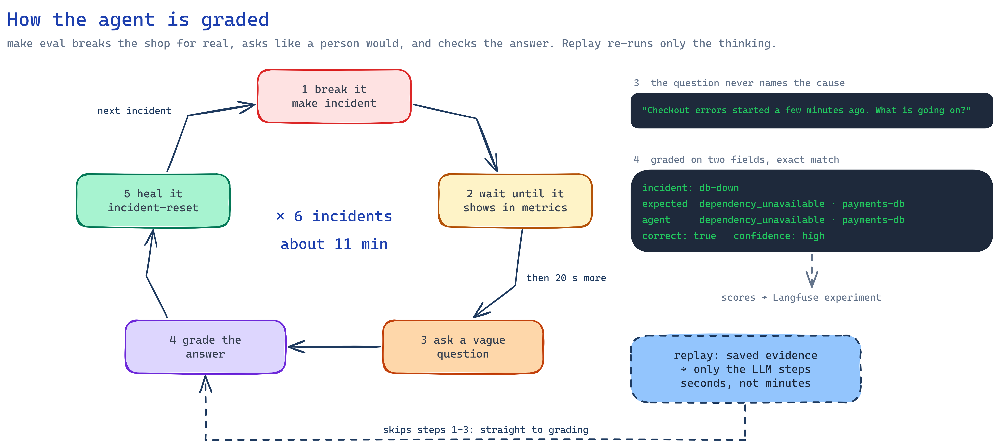
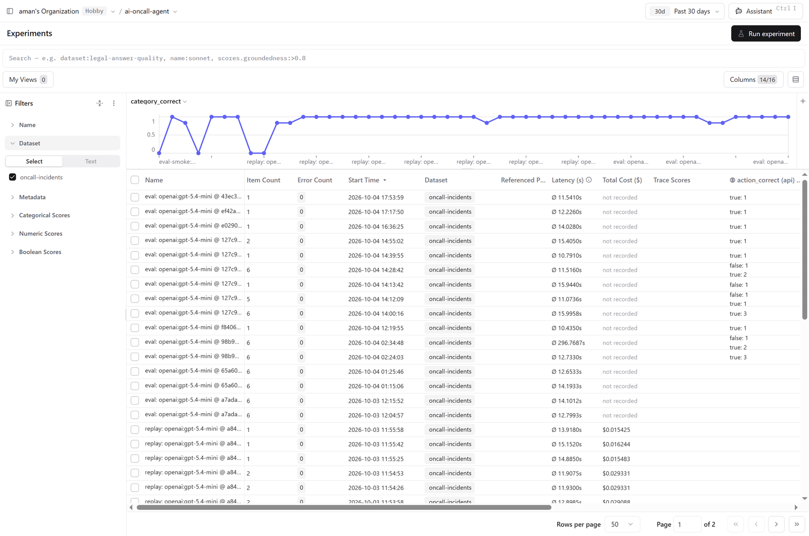

# Evaluation

How do you know an AI agent is actually good, and not just good at the one example you tried? You
break things on purpose, ask it what's wrong, and grade the answer. Then you do it again after
every change.

## Breaking things on purpose

There are six realistic failures, each something that really happens in production. Each one is a
small change on top of the healthy shop (a Kustomize overlay in `lab/kubernetes/incidents/<name>`).

| Incident | What breaks | What the agent should say |
| --- | --- | --- |
| `payment-down` | payment-service has no pods left | payment-service is unavailable |
| `db-down` | The Postgres database is down → payment-service fails → order-service fails | **payments-db** is unavailable, two hops away from the symptom |
| `bad-deploy` | A new payment-service version fails every payment, but its pods look perfectly healthy | bad deployment of payment-service |
| `crash-loop` | A config change removes payment-service's API key, so every pod crashes at startup | payment-service is crash-looping |
| `high-cpu` | user-service does heavy work per request and hits its CPU limit | user-service is out of CPU |
| `slow-payments` | payment-service takes 3 seconds per request | payment-service is a slow dependency |

```bash
make incident NAME=db-down    # break it
make incident-reset           # fix it
```

These aren't simulations. The services really misbehave, switched on by a `FAULT_MODE` setting
that only the incident overlays set.

## Grading the agent

With the cluster and the stack running, `make eval` goes through every incident:

1. Break the system.
2. Wait until the problem actually shows up in Prometheus or in pod restarts.
3. Ask the agent a vague question, the way a real person would, without naming the cause
   ("Checkout errors started a few minutes ago. What is going on?").
4. Check the report: is the **cause category** right, and is the **root-cause service** right?
5. Fix the system and wait until it's healthy again.

Results are printed as a table and saved to `evals/results/`. To run just a few incidents:
`make eval NAME=db-down,high-cpu`. A full run takes about 11 minutes.

<p align="center"></p>

<p align="center"></p>

## What the evals caught

This is where the real learning happened. Every one of these was found by an eval failing, not
by trying the agent by hand:

- **payment-service never recovered after a database restart.** It created its table only once
  per process, so it kept failing after the database came back.
- **Latency maxed out at exactly 1000 ms.** The default histogram buckets stopped there.
- **Average CPU hid the real problem.** A service stuck at its CPU limit can look fine on average.
  Prometheus now also reads CPU *throttling* from the kubelet.
- **Logs came back as one big string with no timestamps,** so old errors looked like new ones.
  Each line now has its own timestamp.
- **Leftovers from the previous incident fooled the agent:** events from pods that no longer exist,
  health-check failures from pods that were still starting, old error lines. Stale events are now
  hidden (with a note), the LLM is told the current time, and every metric history comes with its
  latest, min and max value, so "spiked earlier" and "broken right now" look different.
- **Health checks flooded the logs,** pushing the real errors out of view. They're now filtered out.
- **The categories were ambiguous.** A config change that made a service slow looked like a "bad
  deployment". Categories are now chosen by *how* things failed, in a fixed order.
- **The traffic generator went easy exactly when things got slow.** It waited for each answer, so
  load dropped as soon as a service slowed down, and CPU throttling swung between 34% and 66%. Now
  four workers send orders in parallel like real users, and throttling holds steady at 87–97%.
- **The LLM drew the wrong conclusion from the right evidence.** It called a service stuck at its
  CPU limit a "slow dependency", and blamed a service that had been slow during the *previous*
  incident. Now code works out those facts and states them plainly in the prompt, as **computed
  findings**: "X is held at its CPU limit (250m): throttled in 49% of CPU periods", or "Y was slow
  earlier but has recovered".

**Result:** 6/6 in two runs in a row, all with high confidence.

## Replay: try a prompt change in seconds

A full eval takes 11 minutes because the faults have to happen for real. But most changes only
touch the *thinking* part. So `make eval` saves every investigation together with the evidence it
collected, and replay re-runs only the LLM steps on that saved evidence:

```bash
make replay NAME=high-cpu TIMES=5    # same evidence, 5 fresh answers, a few seconds each
```

LLM answers vary from run to run, so running it several times shows whether a prompt change
really helped. Finish with one full `make eval` before keeping the change.

**Why the eval is fast at all:** Prometheus collects metrics every 5 seconds, and rates use a
30-second window, so problems show up (and clear) within seconds. The eval waits 20 seconds after
a problem appears before asking, like an alert that has to stay firing for a while.

## Comparing runs in Langfuse

Every `make eval` and `make replay` run is saved in Langfuse as an **experiment**, so you can put
two runs side by side and compare them: did the new prompt get more right? Did the cheaper model
cost less, and what did it get wrong?

- The six incidents are a dataset called `oncall-incidents`.
- Each run is named after what produced it, for example
  `eval: openai:gpt-5.4-mini @ 40f7795 (2026-10-02 18:30)` (with `-dirty` if there were uncommitted
  changes).
- Every incident gets scores: `correct`, `category_correct`, `service_correct`, the agent's
  `confidence`, and `action_correct` for the suggested fix.
- Each score links to the full trace of that investigation, even though the eval runner and the
  AI server are separate programs. The eval passes a `traceparent` header along with the
  question, so both sides end up in the same trace.

**To compare two models or prompts:** run `make eval` (or `make replay`), change `LLM_MODEL` or the
prompt, run it again, then open **Experiments** in Langfuse.

Here's the list of runs, with the share of correct answers per run along the top and latency and
cost per run in the table:

<p align="center"></p>

Select two runs and click **Compare**, and Langfuse puts them side by side, incident by incident.
This is the model-routing test: the same saved evidence, once with the cheaper model writing the
report (left) and once with gpt-5.4-mini for every step (right). The cheaper setup got 83% right
against 100%, and the bottom row shows the incident it missed: high-cpu.

<p align="center"></p>

Without Langfuse keys, evals work exactly the same; nothing is recorded, and a Langfuse error
never stops a run.

**In the code:** `evals/incident_cases.py` (the six cases), `run_eval.py`, `replay.py`,
`experiment_tracking.py`.
