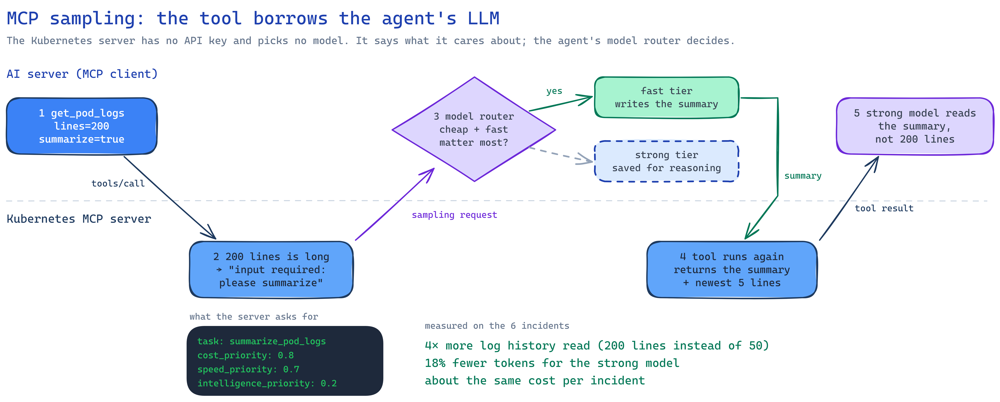
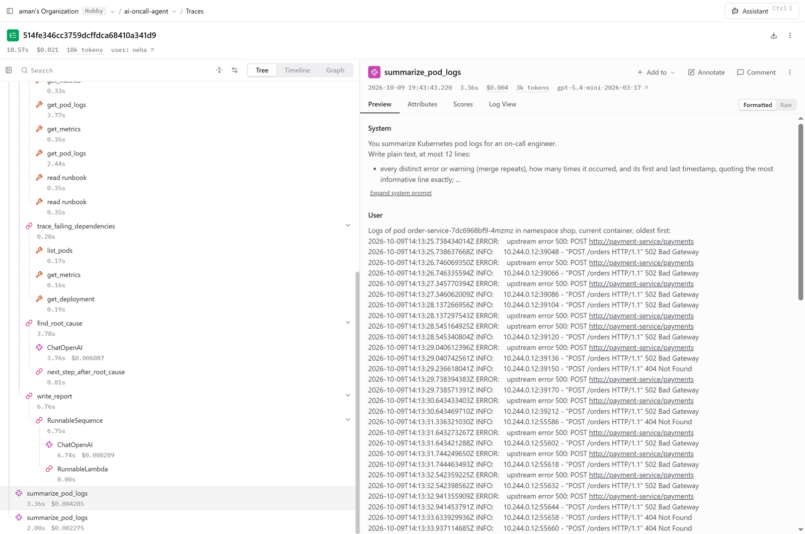

# Advanced MCP features

Most MCP demos stop at "the AI can call tools". MCP can do quite a bit more, and this page covers
the parts that made the agent noticeably better: giving it the team's knowledge, keeping it away
from dangerous tools, and saving money on long logs.

## Giving the agent the team's runbooks (resources)

Tools show what's happening *right now*. But an engineer who's been on the team for a year knows
things no dashboard shows: "payment-service talks to Postgres on 5432", "if you see
`database unavailable`, check payments-db first", "restarting this one is safe, that one isn't".

MCP **resources** are how the server shares that kind of knowledge: read-only documents with an
address, like a URL. A tool is something the *LLM* decides to call; a resource is something the
*app* reads and hands to the LLM.

| Resource | What's in it |
| --- | --- |
| `runbook://{service}` | The service's runbook: what it depends on, what its log messages mean, known failure modes, safe actions (Markdown files in `mcp-platform/server/knowledge/runbooks/`) |
| `topology://{namespace}` | The service map: who calls whom (JSON in `mcp-platform/server/knowledge/topology/`) |
| `k8s://{namespace}/deployments/{name}` | A deployment's live configuration: image, *names* of environment variables and config, CPU and memory, health checks; never secret values |

The agent reads them during its normal checks: the service map first, then the runbook of every
service that looks broken or that the logs blame. They go into the evidence as "documented
knowledge", and the prompt says plainly: **if the runbook and the live data disagree, trust the
live data.** Runbooks go stale; logs don't lie about the present.

**Try it:** open MCP Inspector → Resources → `runbook://payment-service`.

**Did it help?** It didn't change the scores: 6/6 both with and without runbooks, for about 4%
more input tokens at the same cost. The agent was already passing all six incidents, so there was
no room to improve. The runbooks should pay off on harder incidents (Phase 23 adds more).

## Keeping dangerous tools away from the agent (annotations)

Once the server got tools that can *change* things (rollback, scale, restart), it became
important that the investigating agent can never even see them.

- **Every tool carries a label:** read-only or destructive. The AI server only hands the agent
  tools labelled read-only. A tool with no label is treated as unsafe, logged, and left out.
- **`GET /tools` shows the labels,** so you can check what the agent gets.
- **Labels are a hint, not security.** The real protection is still Kubernetes permissions: the
  investigating server's account can't write anything anyway.

**Completions** are the small quality-of-life feature next to it: autocomplete for resource
names in MCP clients. Type `runbook://pay` and get `payment-service` and `payments-db`. (MCP has
completions for resource and prompt arguments, not for tool arguments.)

## Summarizing long logs (sampling + model routing)

Logs are expensive. Every line goes into the strong model's prompt, and twice: once to find the
root cause and once to write the report. Most of those lines are noise.

The fix: summarize the logs first, with a cheap model. The interesting part is *who* does it.

<p align="center"></p>

**MCP sampling** means the *server* asks the *agent's* LLM to do some work. The Kubernetes server
has no API key and no model of its own. It just says what it would like ("cheap, fast, doesn't
need to be clever") and the agent decides which model answers. You can see this in the live demo:
the two `MCP sampling request: summarize_pod_logs` lines.

In Langfuse, each sampling request shows up as its own LLM call in the investigation's trace,
with the instructions the server sent and the raw log lines it wants summarized:

<p align="center"></p>

**Model routing** is how the agent decides. There are two tiers:

```bash
# ai-server/.env
LLM_MODEL=openai:gpt-5.4-mini        # strong: finding the root cause, writing the report
LLM_MODEL_FAST=openai:gpt-5.4-nano   # fast and cheap: log summaries
SUMMARIZE_LOGS=true
LOG_LINES=200                        # summaries make reading more history affordable
```

Sampling requests go to whichever tier their preferences describe. Graph steps go to the strong
tier unless they're listed in `FAST_MODEL_STEPS`. Without `LLM_MODEL_FAST`, everything uses the
one model, as before.

Safety nets: summaries are capped per investigation, every one is recorded in the trace and shown
in the live stream, and if a summary fails the agent just gets the raw lines.

### What it bought

| Setup | Log lines read | Strong-model input tokens per incident | Cost per incident | Correct |
| --- | --- | --- | --- | --- |
| One model, raw logs | 50 | 16,046 | $0.0192 | 4/6 |
| Cheap model summarizes the logs | 200 | 13,206 (−18%) | $0.0203 | 5/6 |
| Cheap model also writes the report (replay) | — | — | ~$0.012 (−40%) | 5/6, and high-cpu only 1/3 on repeats |

So the agent reads **4× more log history** while the strong model sees **fewer** tokens, for
about the same money.

The tempting next step, letting the cheap model write the report too, cut cost by 40% but got
the hardest incident wrong. The report step decides the cause category, so it stays on the strong
model. One run per setup is within normal LLM noise, so treat small differences with care.

**In the code:** `mcp-platform/server/k8s/pods.py` (asks for the summary),
`ai-server/llm/model_router.py` (picks the model), `ai-server/llm/sampling.py` (answers the
request).
