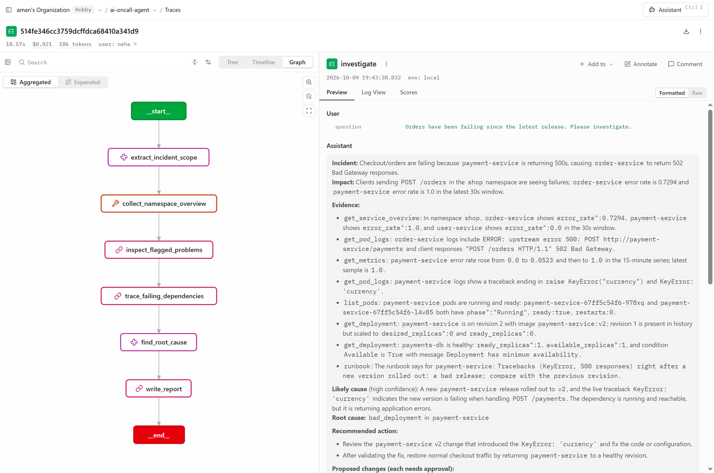

# Observability

When the agent gives a wrong answer, "the AI got it wrong" isn't good enough. You need to see
exactly what it looked at, what it was told, what it said back, and what that cost. And while it's
running, the person who asked shouldn't be staring at a spinner.

## Tracing every investigation with Langfuse

Every investigation is recorded as one **trace** in [Langfuse](https://langfuse.com): a timeline
of every step, every LLM call (the full prompt, the answer, the model, tokens and cost) and every
MCP tool call with its arguments and result.

```text
investigate                           question in, report out
└─ LangGraph
   ├─ extract_incident_scope     → LLM call (tokens, cost)
   ├─ collect_namespace_overview → list_pods, list_events, …   (in parallel)
   ├─ inspect_flagged_problems   → get_pod_logs, get_metrics, …
   ├─ trace_failing_dependencies → list_pods, …
   ├─ find_root_cause            → LLM call ⇄ extra tools it asked for
   └─ write_report               → LLM call
```

Here's the real trace of the bad-deploy demo in Langfuse. On the left, every step and tool call on
a timeline with its duration and cost; on the right, the question and the report the agent wrote.
You can see the fixed checks finishing in under half a second, and the time going to the three
LLM steps and the two log summaries.

<p align="center"></p>

So when a report is wrong, you open its trace and see whether the evidence was missing (a
collection problem) or there and misread (a prompt problem). Those two need very different fixes.
Clicking any LLM call shows exactly what the model was given: here, the root-cause step's system
prompt, the current time, the computed findings and every piece of evidence as JSON.

<p align="center"></p>

The graph view shows the same investigation as the LangGraph flow it ran through:

<p align="center"></p>

It also answers "what does this cost?". Here's the same investigation broken down per LLM call:

<p align="center"></p>

And across a whole month of building and testing (every eval, replay and demo run), the Langfuse
home page adds it up: 188 traces, $3.14 in total, and 649 scores from the evals, with the average
of each.

<p align="center"></p>

### Turn it on

Create a Langfuse project (cloud or self-hosted), go to **Settings → API Keys**, and put the keys in
`ai-server/.env`:

```bash
LANGFUSE_PUBLIC_KEY=pk-lf-...
LANGFUSE_SECRET_KEY=sk-lf-...
LANGFUSE_BASE_URL=https://cloud.langfuse.com   # or https://us.cloud.langfuse.com, or your own
```

From then on, every `/investigate` answer includes a `trace_url`, a direct link to its trace.
Without keys, tracing is simply off.

### Good to know

- **It works with any LLM provider.** Token counts come from LangChain, and Langfuse knows the
  prices of the common models (you can add others under **Settings → Models**).
- **The fixed checks show up too.** They call MCP tools directly, not through the LLM, so each
  call is reported as a tool run and appears under its step like any other tool.
- **Tracing never breaks an investigation.** If Langfuse is down, you only lose the link.
- **Traces contain real data:** the prompts, logs, events and metrics the agent read. With
  Langfuse Cloud they're stored there. Secrets from `.env` are never sent.
- **Joining someone else's trace:** send a W3C `traceparent` header and the investigation is
  recorded inside the caller's trace. The evals use this. You can also tag traces with
  `trace_tags`, for example `["incident:db-down"]`.

**In the code:** `ai-server/tracing.py`.

## Watching it live

An investigation takes 15 to 20 seconds. That feels long when production is down and you're
staring at a blank screen. So `POST /investigate/stream` runs the same investigation and tells you
what it's doing *while* it does it: "checking pods… reading payment-service logs… summarizing…
found it."

```bash
curl -N -X POST http://127.0.0.1:8000/investigate/stream \
     -H "content-type: application/json" -d '{"question": "Checkout is failing"}'
```

Here's the real stream from the bad-deploy demo:

<p align="center"></p>

It uses Server-Sent Events: one HTTP response that stays open and sends small events as things
happen.

| Event | When it arrives |
| --- | --- |
| `step` | A step starts or finishes (with how long it took) |
| `tool` | An MCP tool call starts, finishes or fails; `call_id` pairs them up, since calls run in parallel |
| `progress` | A slow tool reports how far it is, e.g. "error_rate queried in 0.4s" |
| `llm` | An LLM call starts or finishes, with tokens and model; `purpose` is set for sampling requests |
| `note` | The agent explains a decision: a skipped tool, hidden stale events, a dependency it followed |
| `report` / `error` | The end: the full report (same as `/investigate`), or what went wrong |

### How progress gets from the cluster to your screen

It travels in two hops:

1. **MCP server → AI server.** `get_service_overview` runs three Prometheus queries. After each
   one, the server sends an MCP progress notification ("2 of 3 done"). The AI server asks for
   these by passing a `progress_callback` with every tool call.
2. **AI server → you.** Three sources feed one queue: LangChain callbacks (steps, tool calls, LLM
   calls, notes), the MCP progress notifications, and the final report. The endpoint streams that
   queue to you.

**Closing the connection stops the work.** Hit Ctrl+C or close the tab, and the investigation is
cancelled along with its pending LLM and tool calls. Nobody pays for an answer no one is waiting for.

MCP also has a *logging* feature, but it's deprecated as of protocol 2026-07-28, so it isn't used
here. Progress messages and `note` events cover the same need.

**In the code:** `ai-server/investigation/events.py` (the queue and event types),
`mcp-platform/server/prometheus/tools.py` (progress from the Prometheus server).
